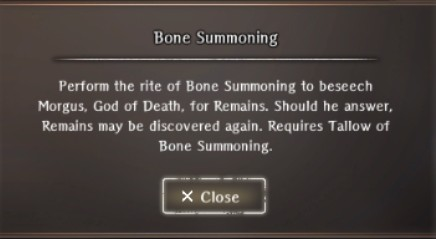
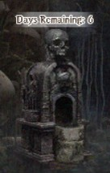
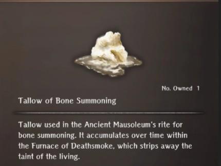
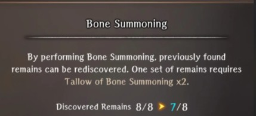
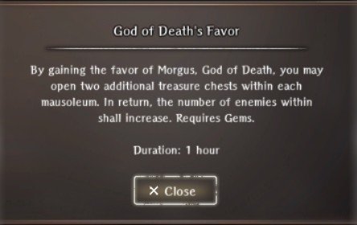
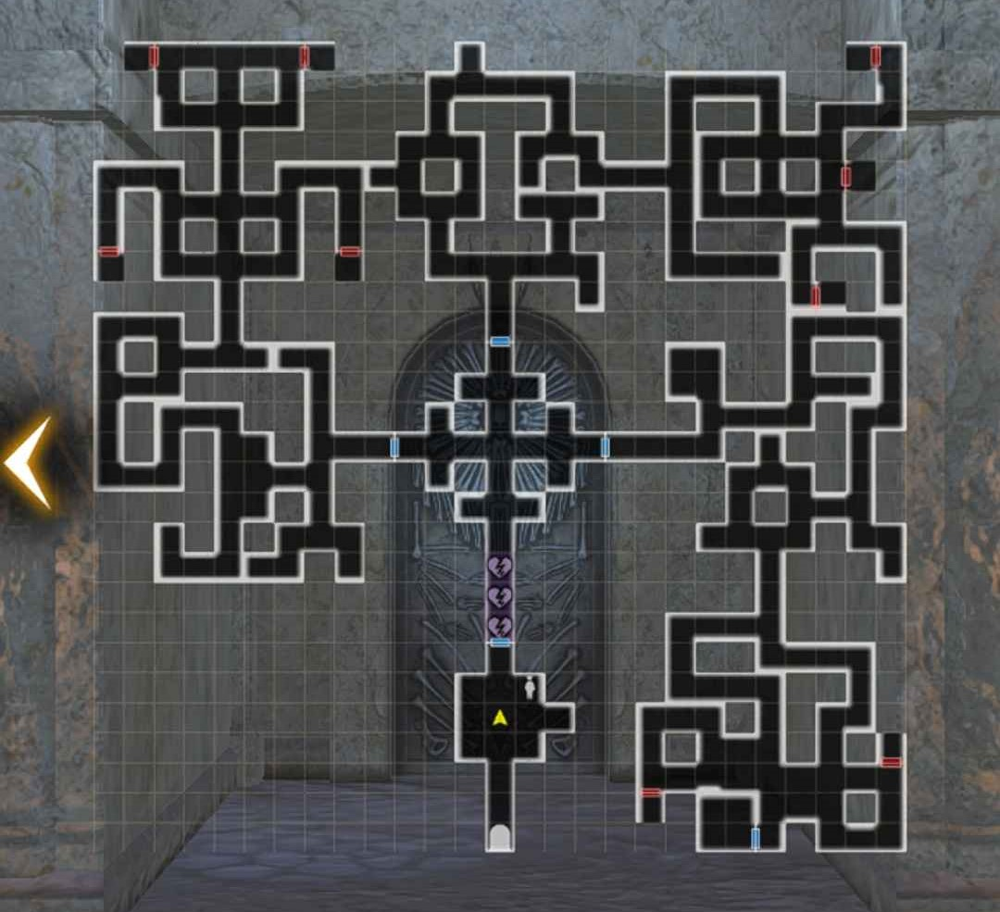
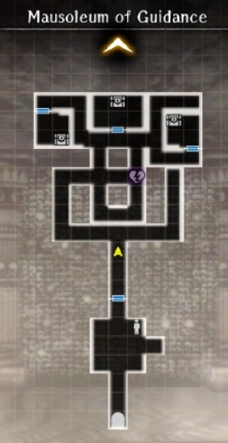
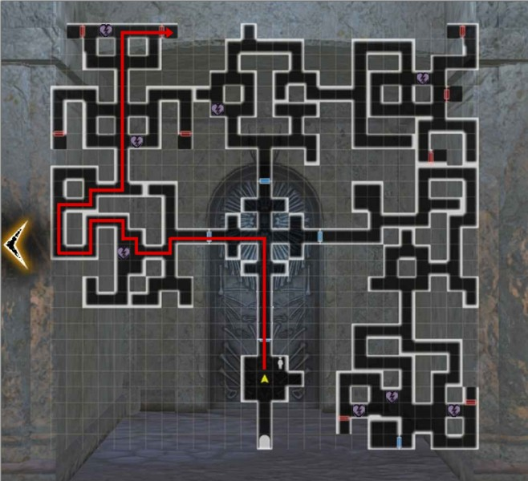

# Ancient Mausoleum  

!!! note "Nov 2026 updates"

    1. A new mausoleum "Tomb of Rarities" was added as a catch-all for the new classes without their own class mausoleum (Samurai, Ninja, Ranger, Healer).  
    1. Any Mausoleum (except for the Mausoleum Guide tomb) from which you have collected all bones are now locked. You cannot progress through the first door, but can still access the guide and altar.  
    1. The Mausoleum map no longer obscures tiles once they have been visited. Each mausoleum is treated as a separate (but identical) map.  Once you explore an area it will forever be visible. You no longer need to set intermediate checkmarks to auto walk to chest rooms, you can simply place a check in the desired room or just auto-walk-to-chest to go to the nearest one.   
    1. In any Mausolum except the Mausoleum Guide tomb, chests that do not give you a bone now give you Bone Fragments instead of Junk. Bone Fragments can be traded at the Jeweler Ossuary at a rate of 10 Fragmets per General Adventurer. This means every 10 mausoleum runs that fail to give you a bone will give you <em>any adventurer of your choosing<em>.  Some people consider this as possibly more valuable than the random distribution of bi-weekly Crucible Mausoleum bones, and are devising strategies to maximize Fragment collection.  
    
    !!! tip "Fragment Optimization Strategies"  
        - Presently, when using the 100 gem [God of Death's Favor](#mausoleum-optional-enhancements) blessing, you can open up to three chests with the penalty of significantly increased numbers of boss fights (it has been confirmed you can get up to 3 bones and no fragments in one visit, but this is being actively debated and may be specific to certain tombs).  
            - So you can get 0 to 3 fragments per visit for as many visits as you can fit into 1 hour, at the cost of 100 gems and assuming you don't run out of available bones (otherwise the tomb will lock).  
        - The [Morgus contract "Contract of Bone Reclamation"](/adventurer-customization/contracts.md#list-of-adventurer-contracts) also increases the number of chests that can be opened in a single visit by 1-3 depending on the number of allies you accept the rather sever stat penalties on.  
        - Bone tallow becomes important for the keeping Mausoleums unlocked for fragment farming, and may be worth hoarding for this purpose.  If you collect the last available bone on a run, you can still open your full allotment of chests, but the mausoleum door will be locked on your next visit. Thus, it may be optimal to only use 1 tallow at a time so that you can never get more than 1 bone per visit and maximize fragments in all other chests.  
        - Combining Death's Favor and Contracts you can get as many as 6 chests per visit, but there are only 2-4 on the different Mausoleum paths, and the time to switch paths isn't much more than just leaving and re-entering, so you could either limit to gems and 1 contracts to reduce ally penalties, or go gem-free with 5 contracts and no extra enemies if you can handle the contract penalties.  
        - <strong>Early tests have shown >100 fragments collected in an hour using combinations of these methods. That's >10 general adventurers <em>of your choice</em> for 100 gems and an hour of furious Mausoleum farming.</strong>  Considering the rather tight gem/adventurer/tag economy in the game, that's a pretty significant feature.

!!! note "As of Jan 2026 the Mausoluem map no longer forgets previous expoloration. It still obscures tiles until you enter them, but the revealed space remembers past progress. This lets you set checkmarks and can greatly speed bone collection."

!!! note "As of Oct 2025 the Fortitude-reducing entry traps are no longer at Mausoleum entrances removing original concerns related to Fortitude-loss, visit rationing, and increased ally revival risk."

### Requirements
The Mausoleum becomes available after defeating the Greater Warped One in the Beginning Abyss and returning to town. It can be accessed from the World Map. There is no level or grade requirement.

### Summary  
The Ancient Mausoleum is a source of guaranteed general/anonymous Adventurer's Remains (bones). You are guaranteed at least one bone for every adventurer entombed in the Mausoleum (all anonymous and basic-class general adventurers). All anonymous adventurers are included together in one smaller floor called the Mausoleum of Guidance.  General adventurer bones have separate but identically laid out larger "floors" for each class.  See [Maps](#maps) below.  Names of Adventurer bones available in each Mausoleum and the number remaining to be found can be seen by tapping the (i) icon at the floor selection screen.

There is a Mausoleum Guide in the entry room who can provide instruction and [some protection](#mausoleum-optional-enhancements) within the Mausoleum for a price.  Additionally, there is an Altar to Morgus, God of Death, that will [provide several options for increasing the number of available bones](#mausoleum-optional-enhancements).  Most Mausoleum enemies are the same as encountered in the Beginning Abyss, but are significantly stronger and all undead have an Insta-kill physical attack. Enemy level will also scale with you, which can make battles very challenging if you are below level 30. 

### Mausoleum Overview
- You must have 6 people in your party to enter. They don't all have to be alive.
- You can find bone chests that will randomly drop either one of the unclaimed Adventurer bones for that Mausoleum or some class-specific junk. After all bones for that mausoleum have been found the room chests will only drop class-specific junk.  Class-specific and anonymous mausoleums do not reset on their own and there is little reason to return to a mausoleum where bones have been claimed.   
- You can only obtain one bone per Mausoleum visit (exceptions below).  Opening any of the bone chests will lock all other bone room doors until you leave the Mausoleum. All doors will unlock again on your next entry, and there is no limit to how many times you may leave and return.  
- Enemies might drop chests that drop include Gold, Azure Ore, Minor potions, and Class-Specific Equipment Junk. Loot is generally poor and the Mausoleum is not recommended for loot farming.  
- There are poison traps scattered throughout the floor that will significantly reduce fortitude but they can all be navigated around.  

### Crucible Mausoleum  
The Crucible Mausoleum floor is unique in that it contains a random selection of 4-6 general adventurer bones and *it resets every 2 weeks* (historically this has occurred every other Sunday at 00:00 JST). The map is the same as that of the general Ancient Mausoleum, though the scenery is slightly different. Again, available adventurer names and the number obtained can be seen by tapping the (i) icon at the floor selection screen. *It's highly suggested to clear this out everytime it resets*, as it is a regular source of adventurer bones for aquiring party members, for Skill Inheritance or Discipline, or for Guild Tags ([See Adventurer's Remains Economy Page](../../appendices/free-to-play-economy.md#adventurers-remains)), and it is now one of the options for clearing your weekly missions (so maybe split the bones over two weeks between resets).

### Mausoleum Optional Enhancements  
??? note "Altar of Morgus: Tallow Bone Summoning"  
      
    
    Bone tallow lets you make more bones available at class-specific Mausoleums.  The player can collect Tallow of Bone Summoning for free from the Furnace of Deathsmoke (on the Mausoleum floor selection screen) and from the Abyss wandering Bone Collector (purchased for 10,000gp).  Each can be obtained once every 7 days.  
    
       
    
    By using two Tallows at an Altar of Morgus, the number of claimed bones in that Mausoleum can be reduced by one. This means that a previously 'emptied' Mausoleum could then produce one extra (random) Adventurer from that Mausoleum's list.  Other than the consumed Tallow, there is no other cost to doing this, and it is ecouraged to be done regularly as it increases the game's otherwise limited bone resource.  There are [strategy suggestions to use this to maximum advantage below](#mausoleum-strategies).

       

??? note "Altar of Morgus: God of Death's Favor"    
       
    The one chest per visit limit can be increased by making a sacrifice of 100 Gems at the Altar of Morgus.  After paying the Gems, a one hour countdown will begin during which time you will be allowed to open up to three doors per visit to the Mausoleum before the remaining doors lock. You can leave and re-enter the mausoleum as many times as you want during that hour, opening up to three chests each time. Note the warning though, that the number of enemies, including wandering necrocores, is increased. Because there is no limitation on simply leaving and reentering the Mausoleum, this is considered a rather low-value use of Gems and is discouraged.

??? note "Mausoleum Guide Protection"  
    
    - The Mausoleum Guide offers to accompany you through the Mausoleum for 100 Gems to protect against the increased danger from undead Insta-kill attacks. During combat, the guide will intercept any Insta-kill attacks from undead (and rascally rabbits). If the attack lands, the Guide will be killed instead of your Adventurer. Otherwise the Guide will act as a mid-level fire mage battle companion, often casting Halito, Mahalito, Katino, and other debuff spells on the enemy.  
    - Once protection is purchased, the Guide will remain a Mausoleum battle companion indefinitely until killed, even over multiple trips to the Mausoleum.  Because of the persistence and ability to mitigate some of the Mausoleum's increased combat danger, the value of this protection can be considered either a good or poor investement according to your risk tolerance.  

### Mausoleum Strategies
??? note "Combat Tips"  

    - Map layout and enemy spawn points do not change.  While a few fights are unavoidable on the path to the chest rooms, most can be waited for and avoided if necessary.  
    - It's recommended to bring undead-bane weapons. High Action Speed will help you go first and kill undead before they get off any insta-kill attacks. Evasion is also a very good stat to have for dodging those instant-kill attacks that get through.
    - Necrocores - undead centaurs -  can be found patrolling right by the chest rooms.  They are the only "large bear shaped" wandering enemy. Avoiding those at lower level is strongly advised.  
    - Marein for priests can instantly kill the most dangerous enemies (who also all tend to stand in rows).  
    - Any Insta-Kill Tolerance items, Malice Helm, Well of Mind Bonuses, etc., can help. Galina improves Instant-kill resistance for adjacent evil characters.  
    - Mustiple casters with row or group damage spells that don't suffer from unhead resistance can significantly improve your survival chances. 
    - Some peolpe appreciate the peace of mind that comes from paying the Mausoleum Guide to accompany you and intercept any insta-kills that slip through.  That includes rabbits.

??? note "Bone Tallow"
    2 bone tallows lets you get another bone from a selected class Mausoleum once per week.  Because bones are randomly chosen from the availability list, there's no way of knowing if you'll get a character you actually want. But, you can take some time to play the statistics a bit to maximize the liklihood of getting a character you want:

    <small>adapted from [Efficient usage of Tallow of Bone Summoning - by BeautifulDemise](https://docs.google.com/document/d/1UiYnFerCGra0724tjVYY_Znvsz13ManglScVBo0Z91M/edit?usp=sharing)</small>  
    
    - Strategy 1: Simply use the tallows on a Mausoleum with a character you want, then get the bone right away and see if you get that character.  E.g., if you want a Dino (to increase your Montino level), use the tallows in the Mage Mausoleum, and you'll have a 1/4 = 25% chance of getting the mage you want.  Do this every week and you're chance of getting at least 1 Dino in N weeks is P(N) = 1 - 0.75^N. (68% likelihood over 4 weeks of getting 1 Dino).
    - Strategy 2: Guarantee you get a Dino by using Tallows until you completely reset the Mage Mausoleum (all 4 Mages), then go get all 4 bones. After four weeks you'll have a 4/4 =  100% chance of getting 1 Dino, with a 'success rate' of 25% (1 Dino, 3 not).
    - Strategy 3: You probably want more than one Dino (level 3 Montino will take 4 Dino copies), and want increased chances of getting him and not the others. You can do that by first following the Strategy 2 approach of resetting the whole Mausoleum to 0 (0/4 for Mages). Then, retrieve bones until you get Dino. At that point stop getting bones. Reset the Mage Mausoleum to 0 again. Then get bones again until you get Dino. Stop. Reset. Repeat.  At the best case you get Dino on the first run.  At the worst case, you repeat the Strategy 2 exercise and it takes 4 runs to get what you want.  You are still guaranteed a 100% chance of getting Dino in 4 runs or less. By resetting right after a success, though, you average fewer unwanted bones (see link above for maths) and will have a higher success rate of 40% in the long run (4 Dino's in 10) versus the Strategy 2 of 25%.
    - Strategy 3.5: You can apply Strategy 3 when you want more than one bone in a Mausoleum. Maybe both Dino and Asha for MONTINO and KATINO, or Jean and Bakesh for their trap skills (2 of 6 from Thief Mausoleum).  In that case you run until you get the two you want, then reset.  Similar math applies, and the success rate will be higher than Strategy 1 or 2.  You can even get really fancy, and maybe you wouldn't mind Amelia's Stealth skill and value it ~half as much as trap skills.  You can use the 'liklihood of success' change as you collect bones to decide when to reset and incease overall success rate. Again, see math linked above. 

??? note "Mausoleum Speed Running"
    !!! warning "Mausoleum enemies can be dangereous for lower level parties, and the fast movement of auto-walking increases chance of accidental ambushes when running into enemies. If you aren't confident of surviving ambushes, you're advise to just walk the path and make deliberate choices to trigger/ambush/avoid the enemies."
    
    - After much trial and error, the path shown on the 'Suggested' map below seems to be the fastest.  By speedwalking that route you can often encounter only 1 'can't dodge' combat, and often even miss any chest room bosses. 
    - As of Jan 2025 update the auto-walk and map behavior has changed. Previously, in addition to whole map tiles being covered, the map would always reset and fill as if it was being explored anew.  Now the tiles still stay covered until you enter them, but the map remembers previousl exploration. This lets you set persistent and see chests. More importantly, they added 'navigate to nearest check/chest' functions, and auto-walking persists after encountering combats and chests.  
    - The speedwalk map below has been updated with checkmarks that can be set on the mausoluem map. After setting these checks, on all subsequent visits you can enter the mausoleum, tap 'auto-walk to check' three times, and it will run you along the 'fastest' path right to the chest. Then tap 'auto-walk to exit' and you're out.  Rinse and repeat until you've gotten all your bones.

### Maps    
!!! map "Ancient Mausoleum"
      

!!! map "Mausoleum of Guidance"   
      

!!! map "Suggested Fast Chest Path with Minimal Fight Potential"   
      

## Credits   
Ancient Mausoleum map provided by Ogarith.  
Map strategy provided by CQ|arglebargle0x4f.  
Tallow Strategy paraphrased from strategy by BeautifulDemise.
