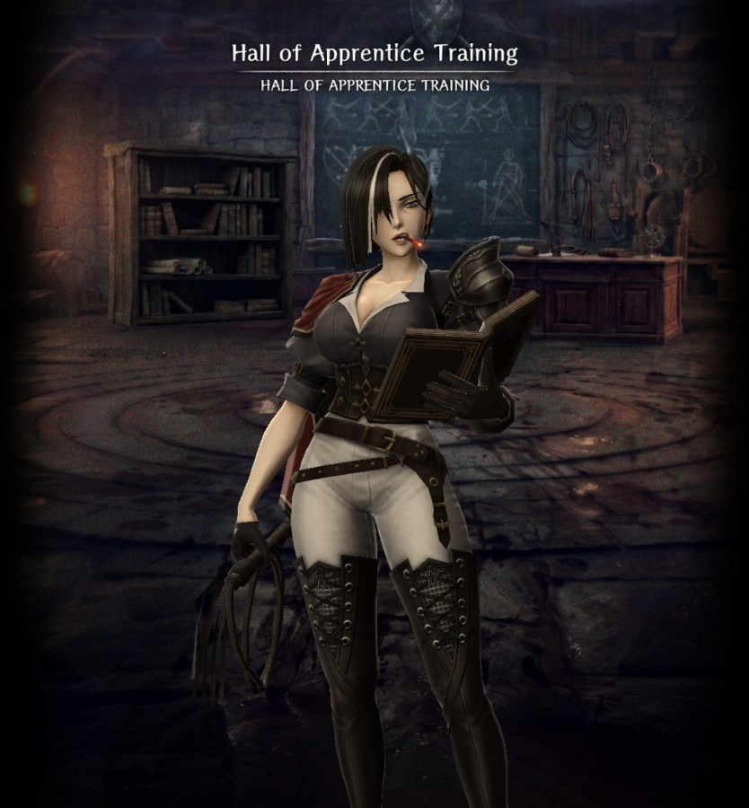

# Hall of Apprentice training{align=right width="400" height=auto}  

## Overview

The Hall of Apprenticentury Training has two primary functions:  

1. [Class Guidance](#class-guidance): Passively increasing your Adventurer's XP/Level plus gaining a one time permanent +10 to max Fortitutde.
2. [Single Inheritance](#single-inheritance): Passing certain skills from one adventurer to another.

The levels obtainable and number of adventurers that can be trained at one time can be increased through [Beatrix Research](#beatrix-research).

### Requirements
Exact trigger unknown. (Abyss 2 completion suggestion by some).  It will appear as an event in the Royal Capital starting with an adventurer complaining about having been treated too roughly by someone (the trainer), after which a Guild cutscene will appear, then a new Apprentice Training button will be found in the Training room.  

### Class Guidance
Work in progress

### Single Inheritance
Work in Progress

!!! warning "Each Ally can be a mentor to only one other Ally, and separately a mentee to only one other Ally. Note this appears to mean, for example, only once with any Adam, alternate styles included, as a mentor per account. Choose wisely."

### Beatrix Research
Work in Progress
