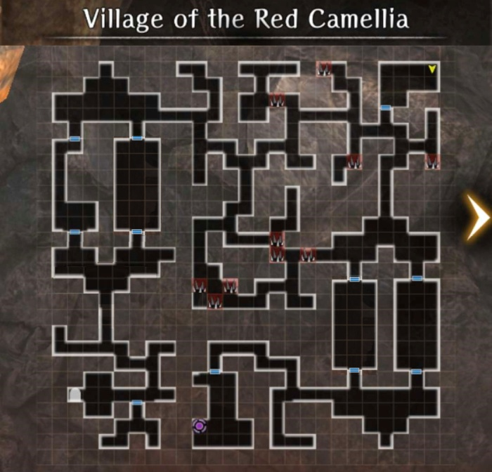

# Retrieving the Scroll of Secret Teachings

*Work in Progress*

!!! note "New Adventurer Style Switching"
    After completing the Personal Request, the Ally will get a new style. You can freely toggle between new and old styles by going to the Training Room and triple-clicking on their portrait.  

## Request Requirements

* Rinne (Standard style) must be in the party
* Certain Trust Level must be achieved with Rinne.
* Once the requirements are met, the request will appear in the Royal Capital Guild under the Featured Requests tab as "Secret Book Retrieval". (There is no cutscene to indicate the request has been added. She's a sneaky ninja.)  Accept the request and the Village of the Red Camellia will be added to the World Map.

!!! warning "Important Notice" This "request" can only be finished once per character copy. If you missed something, you won't be able to go back for it. So don't rush it!

## Map

## Guide

- It's a fairly straightforward ~~dungeon~~ village.  
- You will have a series of interacitons throughtout the dungeon to expand on character lore  
- Twice, you will be asked questions, and those questions will result in you going through one of two doors. Either answer will result in a fight, but the wrong answer will have a harder fight.  
     1. When the path is lost due to snow, which should you follow? Answer: Horse
     2. Breaths indicate weak enemies, quiet idicates enemies strong enough to high presense.  Answer:  Door with noises.
- In the last room with a teleporter there is a chest with the real quest reward:  Dissipation Skill Scroll
    
!!! warning "DON'T LEAVE WITHOUT OPENING THE CHEST, YOU WON't BE ABLE TO GO BACK FOR IT"

!!! note "According to game notes, certain items (likely indicating the Dissipation Scroll) can only ever be obtained once.  It is suspected this means performing the quest with multiple copies of Rinne would not result in the ability to get multiple scrolls, unlike objects obtained in other Legendary Requests."
