# Battlefront of Heroes - Season 2 

!!! danger "This page is under construction"

!!! warning "For more detailed information and discussion"  

    - Visit the [Discord](https://discord.gg/PTBu6WgV) and go to the the Forums - Battlefront of Heroes - Season 2 channel for the most up-to-date information and strategies.  

## Critical Warnings  

!!! danger "Before You Begin - Read Me"  
    - Major Constraints  
        - Once a League has been cleared it cannot be reset. You are automatically advanced to the next one.  
        - The Hero League is a massive difficulty spike. It may not be possible for a normal player to survive the first round. Only a handful of players globally have cleared it to-date.  
        - These two constraints have serious implications on the event's other mechanics.  
    - [Hero's Sigil: Fire](#heros-sigil-fire)   
        - The medal is a one-time only reward. It cannot be farmed, removed, or transferred to another unit. Every time you clear a League the units in your roster gain +1 Level to the passive.  
        - Operate on the assumption that L3 is the effective maximum and plan what units you want to register and in what League order.  
        - Only the first 8 units registered in the Aspirant League have the potential to reach L3 or L4.  
    - [Hero's Reward Missions](#heros-reward-missions)   
    - Doppel Quicksilver  
        - For F2P the 4th Doppel Quicksilver is locked behind clearing the Hero League. This means a maximum of 75 Mastery (Discipline) experience.  
        - Paid pass holders can get up to 5 prior to the Hero League at 1,500 and 3,000 points, respectively.  

## Overview

- Event Period: November 11 - January 13. Drecom has announced plans to release future seasons on an ongoing basis.  
- Battlefront of Heroes is a standard, arena-style challenge with 4 Leagues. The difficulty level, number of matches, and roster size increases as you progress.  
- Each season spotlights a subset of units that are granted a special set of buffs based on certain attributes. For Season 2 it is Fire, Elf/Elvaan, 1H Rods and Odachis. Class or alignment may be added in future seasons.  
- Clearing a League rewards a medal that gives a permanent passive, which can be leveled up. See [Hero's Sigil: Fire](#heros-sigil-fire) for details.  
- The Hero's Reward Missions offer up to 4 Doppel Quicksilver, a new item, which gives 25 Mastery (Discipline) experience to any unit. The other unique rewards are the Warstaff of Honor, a 1H Rod, and War Tachi of Honor, an Odachi.  

## Requirements

=== "How to Unlock"  

    - Battlefront of Heroes unlocks after defeating the first Greater Warped One and saving the King.  

=== "How to Accept" 

    - Enter the Royal Capital for a brief cutscene. Go to the Beginning Abyss - BF2.
    - Speak with the noble. Your choice does not matter. 
    - Speak to the receptionist, Beth, to learn more about the arena's rules and mechanics. 
    - Select "Participate", choose up to 8 members for your roster, and head to the right-hand room to begin your first match. 

## Mechanics

### Basics 

=== "League Structure"

    

    
    | League Name &emsp; &emsp;             | # of Combatants  | # of Rounds  | 
    |:-------------------------------------|:----------------:|:------------:|
    | Aspirant                             | 8                | 4            | 
    | Adept                                | 12               | 8            | 
    | Elite                                | 16               | 12           | 
    | Hero                                 | 20               | 16           | 
     
    

    - There are 4 Leagues this season, but the number of rounds have been reduced. The number of rounds starts at 4 and grows by +4 per League to a maximum of 16. 
    - Enemy levels scale based on the MC's Grade level. 
    - Warning! After a League is cleared it can be re-attempted.
    - Warning! The Hero League is a massive difficulty spike. The difficulty has been adjusted from the first season, but is still a significant step up from Elite.

=== "Registration" 
    
    - For the first League you can register up to 8 members. Each subsequent League lets you add +4 more members up to a maximum of 20. 
    - You do not have to use the same units for each League, but it is -highly- recommended due to how the [medal](#heros-sigil-fire) leveling system works.
    - Dispatched units cannot be registered. 
    - If you fully exit and reset the Battlefront of Heroes, then you must re-register all units.  
    
=== "Pre-Battle"

    - Before each round you can re-arrange your active party using the red "people" icon in the upper right-hand corner.
    - Speak to the Blackiron Warden for a preview of the enemies for the next round. It does not show enemy row placements.  
    - To heal the unit must be in your active party. 
    - To change equipment the unit does not need to be in your active party. 
    - You can use a Resistance buff while in the waiting room or while in the arena before engaging with the enemy. 
    
=== "During Battle" 

    - Referee Intervention 
        - The Referee can set buffs or debuffs at the start of a match. It is limited to a small number of fights per League and not randomized. 
        - The debuffs are not permanent and can be removed with Abit. Priests learn Abit at Level 40 and it is Daniel's Potential inherit. Note that Abit 2 can remove 2 debuffs from an entire row.  
        - The debuffs are extremely powerful. We recommend clearing them immediately or not bringing affected units. 
        - The racial debuffs (Beastfolk, Human) seem to lower all of a unit's stats by a % amount. 
    - Flee 
        - You can Flee at any time with 100% success. Any effects sustained in combat will carry over. This includes regenerated SP/MP from skills, an effect which can be abused to recharge mid-way through the league.
        - No progress is lost.  Any damage done or enemies killed add to totals for mission completion requirements.
        - You are sent back to the waiting area, and can repeat the attempt an unlimited number of times. 
        - In earlier leagues the Blackiron Warden may require you go talk to the Lurking Crow before re-entering.
    
=== "Death" 

    - If MC dies:  
        - "Rise again" 
            - Revived and transported back to the waiting room in your pre-battle condition.  
            - Consumes a Flame of Reawakening. League progress is not lost.  
        - "Be carried out" 
            - MC is revived with 1 HP. Any MP or SP used in the previous fight is not restored. Units that were not revived prior to the MC's death stay dead.
            - Does not consume a Flame of Reawakening. League progress is not lost.  
    - If a party member dies:   
        - If revived they will lose 30 Fortitude as usual. Once Fortitude reaches 0 the unit is "dead" and can no longer be used. Fortitude does not recover while in the arena or waiting area.

=== "Fortitude and Flames"

    - Fortitude does not recover between rounds. If you exit the arena, then the Fortitude of all units is restored to its original level when you first entered.
    - You can gain up to 2 additional Flames of Reawakening in the [Well of the Mind](../../../adventurer-customization/well-of-the-mind.md), allowing you to revive up to 5 times. 
    - Flames of Reawakening recharge while in the waiting room. 

=== "How to Exit the Arena"

    - Ignore the warnings that you are permanently barred from competing if you leave the arena. 
    - To exit you must speak with Beth, the receptionist, and confirm that you want to leave. You will be Cursed Wheel back to the registration desk. You can exit freely at that point or re-register for your current League. 
    - League progress is not saved so you will start over at the first round. 

=== "Cursed Wheel"

    - If you need to Cursed Wheel outside your current Abyss, then the Battlefront of Heroes will disappear from the world map.
    - If your Cursed Wheel node:
        - Puts you in the Royal Capital, then the invitation cutscene will automatically trigger. 
        - In a different city, the enter the Royal Capital from the world map. 
    - If it fails to trigger, then enter a different town or dungeon and re-enter the Royal Capital. 
    - Unfortunately, you will have to go to the Beginning Abyss - BF2 and rewatch the scenes again with the noble. 

### Battlefront Rules 

=== "Basics" 

    - The arena provides a set of special buffs during combat called "Battlefront Rules" for units that are Fire, Elf/Elvaan, or use 1H Rods/Odachis. 
    - Each special buff is significant and scales with each League. It is most impactful and useful for the Elite and Hero Leagues as the lower Leagues can be cleared with just about any team composition. 
    - We recommend you change MC's Type to Fire and Race to Elf in the [Well of the Mind](../../../adventurer-customization/well-of-the-mind.md). The Type node locations do not change, but the 3 elements are randomly determined each time you reset.      
    
=== "Modifiers" 

    === "Table" 

        

        | Requirement &emsp; &emsp; &emsp;    | Description          | Aspirant | Adept | Elite | Hero |
        |:----------------|:----------------------------------|--------- |-------|-------|------|
        | Fire Type       | All stats increased               | 1.2x     | 1.3x  | 1.4x  | 1.5x |
        | Elf/Elvaan      | Attack and Magic Power increased &emsp; &emsp; &emsp;  | 1.3x  | 1.4x  | 1.5x  | 1.6x |
        | 1H Rod          | Damage increased                  | 1.4x     | 1.6x  | 2.2x  | 4.5x |
        | Odachi          | Damage increased                  | 1.2x     | 1.3x  | 1.6x  | 2.5x |

        

        - We are in the process of verifying whether the special buffs stack and how they interact with other damage passives. 
        - The scaling factor per buff is the same for each League. 

    === "Battle Character Screen" 

        

        
        

        - If you click on a character during battle you can see what buffs and debuffs are currently active.

    === "Battle Indicator"
    
        

        
        

        - The red diamonds represent the number of active special buffs. 

=== "Restrictions" 

    - Use of consumable and support items is prohibited. 
    - The game update states that you cannot leave during a match, but this is not true. You can flee if you need to restart a match.

=== "Fire + Elf Units" 

    - [Camille](../../../adventurers/general-adventurers/details/Camille.md)
    - [Yoizou](../../../adventurers/legendary-adventurers/details/Yoizou.md)
    - [Erwin](../../../adventurers/legendary-adventurers/details/Erwin.md) 
    - See the [Adventurer Quicklist](../../../adventurers/quicklist/adventurer-quicklist.md) for a list of all Elf/Elvaan or Fire units. 

### Lurking Crow Assistance  

!!! warning "Under investigation.  Behavior varies by League."  

=== "Basics"

    - If you are struggling there is a hidden set of Battlefront Rules. They are only available for the first 3 Leagues.  
    - In the waiting room there is an old man, the Lurking Crow, who will normally ignore you. If you flee a battle and speak with the Blackiron Warden (dwarf) afterward he will suggest you speak with Crow.    
    - Interact with Crow and you will get a new set of dialogue. For a fee he will offer an additional set of Battlefront Rules that will buff your team and debuff the enemy for the upcoming round. The assistance is only offered on a per round basis. The steps above must be repeated for each battle. 
    - See next tab for details. 

=== "Crow's Battlefront Rules" 

    === "List"

        

        
        

    === "Mechanics" 

        - Goes into effect once the battle starts. 
        - It can be repeated for each round, but you must flee and repeat the process.  
        - Once applied, it will continue to be applied to this battle round even if you again flee and re-enter the battle.  
        - There does not appear to be any negative consequences or limit to the number of times it can be used. (Under Investigation).  
        - Appears to stack with the standard Battlefront Rules. (Under Investigation). 

    === "Crow Compendium"

        

        
        

=== "Under Investigation"

    - The fee cost per League. 
    - The buff and debuff modifiers (1.x) and whether they scale per League like the standard Battlefront Rules. 
    - Whether there is a cap on the number of times it can be used on the Adept and Elite Leagues. 
    - Whether it is available on the Hero League under certain circumstances. 

=== "League Guides" 

    === "Aspirant"
    
        - Afer fleeing, if you try to re-enter the arena, the Blackiron Warden will say you arent ready and should go talk to the Lurking Crow.  
        - Note you must speak with the Blackiron Warden first, otherwise Crow will not offer you the buff. 
        - Talk Crow and select "I want to win". Pay the 2,000 gp fee. 
        - If you pay the fee, when you re-enter the arena the new Crow buffs will take effect right after the battle starts.  
        - After winning the battle, the crow resets to ignoring you again.  
        - You can repeat this for every battle. There appear to be no negative consequences.  
    
    === "Adept" 
        - Crow fee: 10,000 gp
        - Information pending.
    
    
    === "Elite" 
        - Crow fee: 50,000 gp
        
    === "Hero" 
    
        - Assistance appears to be unavailable. After fleeing from a battle and speaking with the Lurking Crow he will say, "This battle is yours and yours alone to suffer through."  
        - Unclear if there is any way to get additional Hero League assistance, or if this will be adjusted during the season.  
    
## Hero's Sigil: Fire

=== "Basics" 

    - Warning! The medal is a one-time reward after completing all rounds in a League. Each League clear gives an additional level up to L4. It cannot be farmed or reassigned to a different unit. 
    - The medal gives a passive, Hero's Sigil: Fire, that reduces Fire-type damage along with a small boost to HP, MP, and SP. The bonuses for Fire units are doubled. 
    - All members in your Battlefront roster receive the medal even if they do not participate. We recommend you think carefully about what units you want to prioritize before beginning.  
    - It can be viewed on a unit's Stats page under Passive Skills. 
    - Given that the Dark medal EXP can be purchased in limited amounts (600 EXP) in future seasons, one can assume the same will be applied for the Fire medal in the next season. 
    - Future seasons will offer additional medals, but only one can be equipped at a time. 

=== "Leveling Mechanics"

    - Each time you clear a League your entire Battlefront roster recieves 100 EXP (or 1 Level) toward the passive skill. 
    - The roster expands by +4 each League. New members can receive the medal, but at a lower max level. 

=== "Stat Gains per Level" 

    

    
    | Stat &emsp; &emsp; &emsp; | L1     | L2     | L3     | L4     | Totals  | 
    |:--------------------|--------|--------|--------|--------|---------|
    | HP                  | 5 (10) |        |        | 5 (10) | 10 (20) |
    | MP                  |        | 5 (10) |        |        | 5 (10)  | 
    | SP                  |        |        | 5 (10) |        | 5 (10)  |  
                 
    

    - Fire units receive a 2x bonus to each stat. Those values are listed as (#). 
    - It is unknown if the Fire-type damage reduction increases with each level.  

=== "Max Level per League Entry Point"

    

    | League Name &emsp; &emsp; &emsp;     | Aspirant | Adept | Elite | Hero | Max Level | Max # of Units | 
    |:-------------------------------------|:--------:|:-----:|:-----:|:----:|:---------:|:--------------:|
    | Aspirant                             | +1       | +1    | +1    | +1   | 4         | 8              |     
    | Adept                                |          | +1    | +1    | +1   | 3         | 4              | 
    | Elite                                |          |       | +1    | +1   | 2         | 4              |
    | Hero                                 |          |       |       | +1   | 1         | 4              |
     
    

=== "Trade-offs"

    Unit selection can be complicated, but here are some things to consider:
    
    - Prioritize your core, long-term units for the incremental stat bonuses and Dark damage reduction. 
    - Maximize the 2x stat bonus for Fire units. 
    - Fire Knights gain +10 SP at L3, which is extremely helpful due to their low SP pools even with high Discipline levels. 
    - Improve the survivability of Wind units by giving them at least L1 of the medal. Dark bosses and super bosses are very common. 

## Hero's Reward Missions 
    
### Basics  

!!! warning "Summary" 

    - It requires a total of 6,500 point to clear the Hero's Reward Mission.  
    - There is a maximum of 9,120 total points from all sources. It is possible to clear the entire Mission set before even leaving Aspirant League.  
    - Excluding the Hero League, you have a 1,820 point buffer in case you are unable to complete certain achievements or miss points from the Weekly achievements.
    - Mission achievements, progress, and rewards can only be accessed while in the arena.  
    - Many mission achievements that don't specify winning can be completed even if you flee or lose the battles.  

### Points by Category 

=== "League"

    

    | League Name &emsp; &emsp; &emsp; &emsp;      | Rounds | Clear | Total | Cumulative |  
    |:-------------------------------------|--------|-------|-------|------------|
    | Sign-up                              |        |       | 100   | 100        | 
    | Aspirant                             | 400    | 200   | 600   | 700        |      
    | Adept                                | 400    | 200   | 600   | 1,300      |  
    | Elite                                | 400    | 200   | 600   | 1,900      | 
    | Hero                                 | 400    | 200   | 600   | 2,500      | 
    | Hero - No Deaths                     |        |       | 200   | 2,700      | 

    

    - The round achievements are worth 100 points. Clearing a League is worth 200 points. 
    - Clearing everything through Elite gives you 1,900 points. 
    - If you do not progress through the Hero League, then you will need 4,600 points to reach the 6,500 points for all Mission rewards. 

=== "Special" 

    

    | Requirement &emsp; &emsp; &emsp; &emsp;      | 1   | 2   | 3   | 4   | 5   | Total |  
    |:-------------------------------------|:---:|:---:|:---:|:---:|:---:|:-----:|
    | Fire-type                            | 100 | 100 | 100 | 100 | 200 | 600   |      
    | Elf                                  | 100 | 100 | 100 | 100 | 200 | 600   |  
    | Mage                                 | 100 | 100 | 100 |     |     | 300   |   
    | Odachi                               | 100 | 100 | 200 |     |     | 400   |   
    | 1H Rod                               | 100 | 100 | 200 |     |     | 400   | 
    |                                      | --- | --- | --- | --- | --- | ---   |     
    | Total                                | 500 | 500 | 700 | 200 | 400 | 2,300 |      

    

    - These achievements refer to the "Win using at least X adventurers". The number of required members are the column headings (1-5). 
    - MC does not count toward the Fire units achievement. 
    - The Special achievements are worth a total of 2,300 points. If you cannot make progress on the Hero League this will be one of your primary sources for reaching 6,500 points for all Mission rewards. 

=== "Damage: One-Hit" 

    

    | Damage Required &emsp; &emsp; &emsp;          | Total   | Cumulative |  
    |:--------------------------------:|:-------:|:------------:|
    | 200                              | 100 | 100   |       
    | 400                              | 100 | 200   | 
    | 600                              | 100 | 300   |    
    | 900                              | 100 | 400   | 
    | 1,500                            | 100 | 500   |       
    | 1,800                            | 100 | 600   | 
    | 2,200                            | 100 | 700   |    
    | 2,600                            | 100 | 800   | 
    | 3,000                            | 100 | 900   |       
    | 5,000                            | 100 | 1,000 | 
    | 7,000                            | 100 | 1,100 |    
    | 10,000                           | 100 | 1,200 | 

    

    - Each achievement is worth 100 points for a total of 1,200 points. 
    - Multi-hit weapons and attacks such as Hue count as "one-hit". 
    - Even if you flee or lose, the damage done in a round is still counted.
    - Strongly recommend doing the 10,000 damage achievement on a lower League. Have the Lurking Crow buff active, sleep or freeze a weak enemy, and hit them with your strongest skill using a Dark Human equipped with a 2H sword. 

=== "Damage: Total" 

    

    | Damage Required &emsp; &emsp; &emsp;                      | Total| Cumulative |  
    |:---------------------------------------:|:-------:|:------------:|
    | 3,000                                   | 100 | 100   |       
    | 6,000                                   | 100 | 200   | 
    | 9,000                                   | 100 | 300   |    
    | 30,000                                  | 100 | 400   | 
    | 60,000                                  | 100 | 500   |       
    | 90,000                                  | 100 | 600   | 
    | 120,000                                 | 100 | 700   |    
    | 160,000                                 | 100 | 800   | 
    | 200,000                                 | 100 | 900   |       
    | 300,000                                 | 100 | 1,000 | 
    | 600,000                                 | 100 | 1,100 |    
    | 900,000                                 | 100 | 1,200 |    

    

    - Each achievement is worth 100 points for a total of 1,200 points. 
    - Even if you flee or lose, the damage done in a round is still counted. 
    - Strongly recommend farming the total damage achievements in the Aspirant and Adept Leagues depending on your Abyss progress and account power.  Stacking high power attacks like you would use for the One-Hit missions will accumulate total damage quickly.

=== "Weekly" 

    

    | Requirement                             | Total| Cumulative |  
    |:----------------------------------------|:-------:|:------------:|
    | Defeat 5 monsters                       | 30 | 30  |       
    | Defeat 10 monsters                      | 30 | 60  | 
    | Defeat 20 monsters                      | 30 | 90  |    
    | Deal a total of 5,000 damage            | 30 | 120 | 
    | Deal a total of 10,000 damage           | 30 | 150 |       
    | Deal a total of 20,000 damage &emsp; &emsp; &emsp; &emsp; &emsp;           | 30 | 180 | 

    

    - There are 8-9 weekly missions during the season (depending on how partial weeks are handled. Following calculations will assume 9).  
    - Each achievement is worth 30 points for a total of 180 points per week (Total: 1,620 points over 9 weeks).  
    - Note: We do not know if the requirements will change week-to-week or if these will stay constant.  

=== "All"

    

    | Major Achievement Category &emsp; &emsp; &emsp; &emsp; &emsp;                      | Total | 
    |:-----------------------------------|--------|
    | From League:                       |        | 
    | &emsp; Registration                | 100   | 
    | &emsp; Aspirant                    | 600   |  
    | &emsp; Adept                       | 600   | 
    | &emsp; Elite                       | 600   | 
    | &emsp; Hero                        | 600   | 
    | &emsp; Hero - No Deaths            | 200   |     
    | Special                            | 2,400 |     
    | Damage: One-Hit                    | 1,200 |
    | Damage: Total                      | 1,200 |    
    | Weekly                             | 1,620 | 
    |                                    | ----- |
    | Grand Total                        | 9,420 |    

    - There are a total of 9,120 points available. Reduce that number by 800 if Hero is unclearable for you and the net result is 8,320. 
    - That leaves a buffer of 1,820 points (8,320 - 6,500), giving quite some flexibility on what achievements you can ignore and/or be unable to fulfill if you're stuck in a high-difficulty League. 
    - Note: 
        - 6,560 points can be earned by Registering, completing all Special, Damage: One-Hit, Damage: Total, and 7 Weekly Missions, and only beating the first Aspirant battle.  
        - So even if the event cannot be completed, _all Event rewards except the Hero's Sigil are achievable_ by anyone eligible to enter the Arena.

    

### Arena Rewards

- Complete Mission achievements to earn points to unlock rewards. Rewards are granted every 100 points.   
- Note that not all rewards can be obtained by F2P players.

#### Notable Items

=== "Warstaff of Honor" 

    === "+20"

        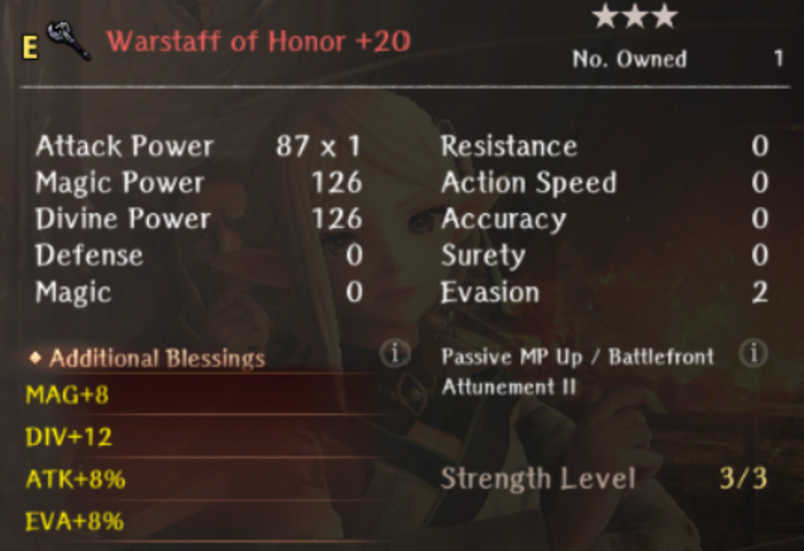{ width="550" }

=== "War Tachi of Honor" 

    === "+20"

        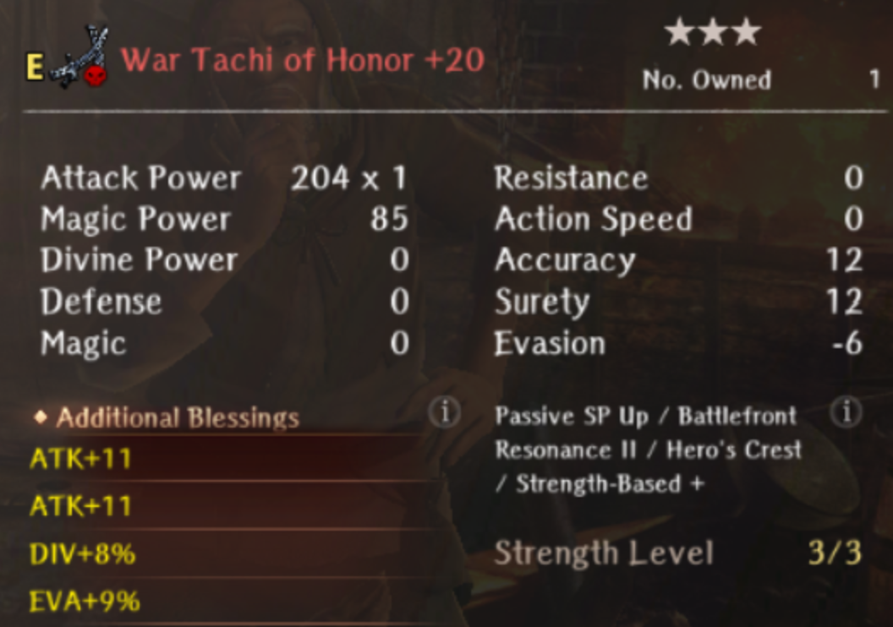{ width="550" }

=== "Doppel Quicksilver" 

    === "Basics" 

        - First time that Drecom has released an item that gives Mastery (Discipline) experience. Each one gives 25 Mastery.
        - As noted F2P will only be able to get 3 copies (75 Mastery) unless you can clear the Hero League. The paid pass provides 2 additional ones for a total of 5.
        - Recommended uses:
            - Limited banner unit that you want to invest in long-term. Future seasons are likely to provide additional copies. 
            - Alternative style unit to reach D1 for [Shared Discipline](../../../mechanics/merging.md#shared-discipline). This can help avoid having to pity (100 pulls) an extra copy and save your green gems for other banners.

    === "How to Obtain"

        

    
        | Requirement                                     | #  | 
        |:------------------------------------|----|
        | Clear the Aspirant League &emsp; &emsp; &emsp;  &emsp;           | 1 |  
        | Clear the Adept League              | 1 | 
        | Clear the Elite League              | 1 |  
        | Clear the Hero League               | 1 | 
        | F2P Total                           | 4 | 
        | Paid Pass Only:                     |   |  
        | Awarded at 1,500 Points             | 1 |  
        | Awarded at 3,000 Points             | 1 |  
        | Paid Pass Total                     | 6 |  

        

    === "Description" 

        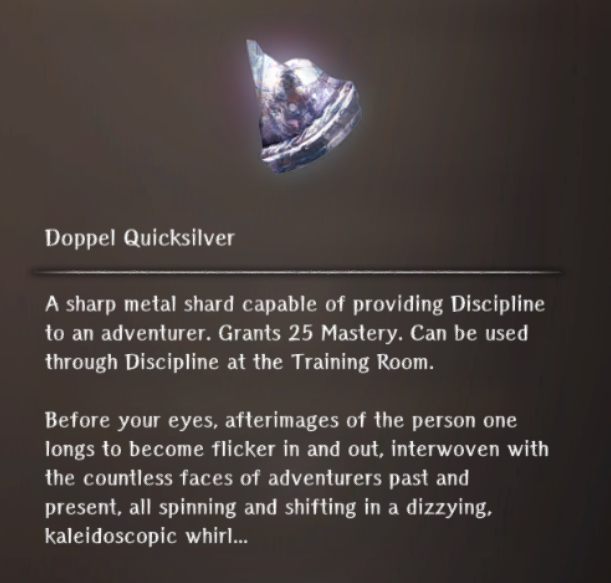{ width="500" }

    === "Discipline Menu" 

        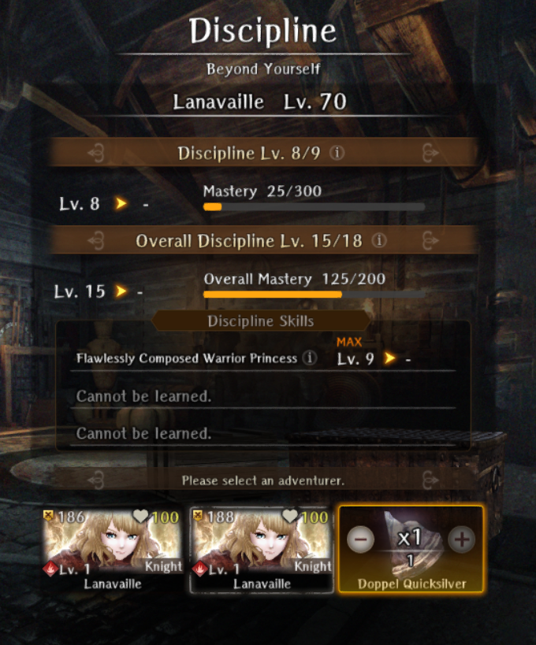{ width="500" }

        - When you go to the Training Room - Discipline with a unit you will now see the Doppel Quicksilver as an available option. 

#### Rewards List 

=== "Summary" 

    - The Reward Lists are organized into F2P and Paid Pass columns. 
    - Without the paid pass you will only receive enough unification material (x9) to take the Heavy Warblade of Honor to +15. 
    - Since the Hero League is effectively impossible to clear it means most players will only receive 3x Doppel Quicksilvers or 75 Mastery (Discipline) experience. Paid pass members receive 2 extra at 1,500 and 3,000 points, respectively. 
    - Rewards are given automatically after the achievement has been submitted as complete. 

=== "F2P Rewards"  

    

    
    | Category                            | Description                                                                    | 
    |:------------------------------------|--------------------------------------------------------------------------------|
    | Doppel Quicksilver                  | 4x (The 4th is locked behind clearing Hero League)                             |  
    | Heavy Warblade of Honor (HwOH) &emsp; &emsp;  &emsp;      | 1x Ebonsteel, 2H Sword with unique traits                |
    | HWoH Unification Material           | 9x (Enhance up to +15.                                                         |
    | Gold                                | 600,000                                                                        |
    | Gems of Org                         | 200                                                                            |
    | Bones                               | 1x Gandolfo, 2x Adventurer Remains I, 2x Adventurer Remains II                 |
    | Iron Ore                            | 30x Low, 30x Mid, 30x High, 5x Fine, 3x Silver                                 |
    | Skill Scrolls                       | 1x Zelos, 1x Mazelos, 1x Earth-Splitting Strike, 1x Codex of Learning (25 EXP) |
    | Guild Tags                          | 6x Ungraded Tags                                                               |
    | Alteration Stones                   | 2x Lesser Full Alteration Stones                                               |
    
    

=== "Mission Pass Additional Rewards"    

      

=== "F2P Reward Milestones"  

    

    | Total Points Required &emsp; &emsp; &emsp;                      | F2P Reward | Mission Pass Reward | 
    |:--------------------------:|-------------------------------------|---------------------------------|
    | 100                        | Savage Warrior Remains (Gandolfo)   | 100x Gems of Org                |
    | 200                        | Heavy Warblade of Honor (HWoH)      | 50x Gems of Org                 |
    | 1,000                      | Zelos Skill Scroll                  | 100x Gems of Org                |
    | 1,500                      | 1x Ungraded Guild Tag               | 1x Doppel Quicksilver           |
    | 1,600                      | 100x Gems of Org                    | 100x Gems of Org                |
    | 1,700                      | 1x HWoH Unification Material        | 50x Gems of Org                 |
    | 2,500                      | 1x HWoH Unification Material        | 100x Gems of Org                |
    | 3,100                      | 1x Adventurer Remains I             | 1x Adventurer Remains I         |
    | 3,200                      | 3x HWoH Unification Material        | 9x HWoH Unification Material    |
    | 3,800                      | Mazelos Skill Scroll                | 100x Gems of Org                |   
    | 4,000                      | Full Power Strike Skill Scroll      | 2x Ungraded Guild Tag           |
    | 4,600                      | 1x Adventurer Remains II            | 1x Adventurer Remains II        |
    | 4,700                      | 3x HWH Unification Material         | 9x HWH Unification Material     |
    | 5,300                      | 1x Codex of Learning                | 200x Gems of Org                |
    | 5,400                      | 1x Silver Ore                       | 1x Silver Ore                   |
    | 5,500                      | 1x Lesser Full Alteration Stone     | 1x Lesser Full Alteration Stone |
    | 5,600                      | 1x Adventurer Remains I             | 1x Adventurer Remains I         |
    | 6,000                      | 1x Adventurer Remains I             | 1x Adventurer Remains I         | 
    | 6,100                      | Earth-Splitting Strike Skill Scroll &emsp;  &emsp;  | 1x Ungraded Guild Tag           |
    | 6,400                      | 2x Silver Ore                       | 2x Silver Ore                   |
    | 6,500                      | 1x Lesser Full Alteration Stone     | 1x Full Alteration Stone        | 

    

=== "Full rewards list"  

    

 
    | Total Points Required  &emsp; &emsp; &emsp; | F2P Reward                            | Mission Pass Reward                  |
    |:---------------------:| ------------------------------------- | ------------------------------------ |
    | 100                   | Savage Warrior Remains (Gandolfo)     | 100x Gems of Org                     |
    | 200                   | Heavy Warblade of Honor (HWoH)        | 50x Gems of Org                      |
    | 300                   | 2x Clock Time of Maneuver (36,480xp) &emsp;  &emsp;  | 50x Gems of Org                      |
    | 400                   | 25,000gp                              | 100x Gems of Org                     |
    | 500                   | 10x Low Grade Ore                     | 50x Gems of Org                      |
    | 600                   | 2x Clock Time of Maneuver (36,480xp)  | 50x Gems of Org                      |
    | 700                   | 25,000gp                              | 100x Gems of Org                     |
    | 800                   | 10x Low Grade Ore                     | 50x Gems of Org                      |
    | 900                   | 2x Clock Time of Maneuver (36,480xp)  | 50x Gems of Org                      |
    | 1,000                 | Zelos Skill Scroll                    | 100x Gems of Org                     |
    | 1,100                 | 25,000gp                              | 50x Gems of Org                      |
    | 1,200                 | 2x Clock Time of Maneuver (36,480xp)  | 50x Gems of Org                      |
    | 1,300                 | 10x Low Grade Ore                     | 100x Gems of Org                     |
    | 1,400                 | 25,000gp                              | 100x Gems of Org                     |
    | 1,500                 | 1x Ungraded Guild Tag                 | 1 Doppel Quicksilver                 |
    | 1,600                 | 100x Gems of Org                      | 100x Gems of Org                     |
    | 1,700                 | 1x HWoH Unification Material          | 50x Gems of Org                      |
    | 1,800                 | 4x Clock Time of Maneuver (36,480xp)  | 50x Gems of Org                      |
    | 1,900                 | 40,000gp                              | 100x Gems of Org                     |
    | 2,000                 | 10x Mid Grade Ore                     | 50x Gems of Org                      |
    | 2,100                 | 4x Clock Time of Maneuver (36,480xp)  | 50x Gems of Org                      |
    | 2,200                 | 100x Gems of Org                      | 100x Gems of Org                     |
    | 2,300                 | 10x Mid Grade Ore                     | 50x Gems of Org                      |
    | 2,400                 | 4x Clock Time of Maneuver (36,480xp)  | 50x Gems of Org                      |
    | 2,500                 | 1x HWoH Unification Material          | 100x Gems of Org                     |
    | 2,600                 | 40,000gp                              | 50x Gems of Org                      |
    | 2,700                 | 4x Clock Time of Maneuver (36,480xp)  | 50x Gems of Org                      |
    | 2,800                 | 10x Mid Grade Ore                     | 100x Gems of Org                     |
    | 2,900                 | 40,000gp                              | 100x Gems of Org                     |
    | 3,000                 | 1x Ungraded Guild Tag                 | 1 Doppel Quicksilver                 |
    | 3,100                 | 1x Adventurer Remains I               | 1x Adventurer Remains I              |
    | 3,200                 | 3x HWoH Unification Material          | 9x HWoH Unification Material         |
    | 3,300                 | 5x Clock Time of Maneuver (36,480xp)  | 100x Gems of Org                     |
    | 3,400                 | 50,000gp                              | 25,000gp                             |
    | 3,500                 | 10x High Grade Ore                    | 15x Mid Grade Ore                    |
    | 3,600                 | 5x Clock Time of Maneuver (36,480xp)  | 100x Gems of Org                     |
    | 3,700                 | 50,000gp                              | 25,000gp                             |
    | 3,800                 | Mazelos Skill Scroll                  | 100x Gems of Org                     |
    | 3,900                 | 5x Clock Time of Maneuver (36,480xp)  | 100x Gems of Org                     |
    | 4,000                 | Full Power Strike Skill Scroll        | 2x Ungraded Guild Tag                |
    | 4,100                 | 50,000gp                              | 25,000gp                             |
    | 4,200                 | 5x Clock Time of Maneuver (36,480xp)  | 100x Gems of Org                     |
    | 4,300                 | 10x High Grade Ore                    | 5x High Grade Ore                    |
    | 4,400                 | 50,000gp                              | 25,000gp                             |
    | 4,500                 | 2x Ungraded Guild Tag                 | 2x Ungraded Guild Tag                |
    | 4,600                 | 1x Adventurer Remains II              | 1x Adventurer Remains II             |
    | 4,700                 | 3x HWH Unification Material           | 9x HWH Unification Material          |
    | 4,800                 | 60,000gp                              | 30,000gp                             |
    | 4,900                 | 10x Clock Time of Maneuver (36,480xp) | 200x Gems of Org                     |
    | 5,000                 | 10x High Grade Ore                    | 10x High Grade Ore                   |
    | 5,100                 | 5x Fine Grade Ore                     | 5x Fine Grade Ore                    |
    | 5,200                 | 60,000gp                              | 30,000gp                             |
    | 5,300                 | 1x Codex of Learning (25xp)           | 200x Gems of Org                     |
    | 5,400                 | 1x Silver Ore                         | 1x Silver Ore                        |
    | 5,500                 | 1x Lesser Full Alteration Stone       | 1x Lesser Full Alteration Stone      |
    | 5,600                 | 1x Adventurer Remains I               | 1x Adventurer Remains I              |
    | 5,700                 | 10x Clock Time of Maneuver (36,480xp) | 5x Clock Time of Maneuver (36,480xp) |
    | 5,800                 | 60,000gp                              | 30,000gp                             |
    | 5,900                 | 1x Ungraded Guild Tag                 | 1x Ungraded Guild Tag                |
    | 6,000                 | 1x Adventurer Remains II              | 1x Adventurer Remains II             |
    | 6,100                 | Earth-Splitting Strike Skill Scroll   | 1x Ungraded Guild Tag                |
    | 6,200                 | 60,000gp                              | 30,000gp                             |
    | 6,300                 | 1x Ungraded Guild Tag                 | 1x Ungraded Guild Tag                |
    | 6,400                 | 2x Silver Ore                         | 2x Silver Ore                        |
    | 6,500                 | 1x Lesser Full Alteration Stone       | 1x Full Alteration Stone             |  

    
  
    

## League Battles

!!! note "For this season in particular, it appears that the rounds are the same per league, simply the stats are adjusted."

### Aspirant League

=== "Round 1"

    === "Fight Preview"
        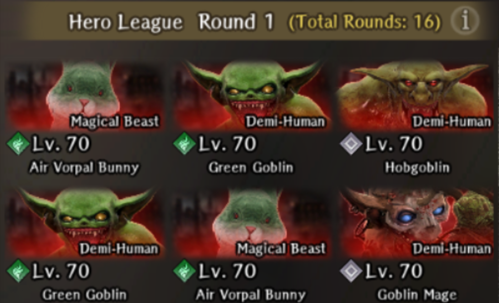{ width="390" }

    === "Enemy Formation"
        - Frontline: Air Vorpal Bunny 2x, Hobgoblin 1x, Green Goblin 2x
        - Midline: Goblin Mage 1x, Goblin Cleric 1x, Goblin Archer 1x
        - Backline: Gluttonous Maw 2x

=== "Round 2"

    === "Fight Preview"
        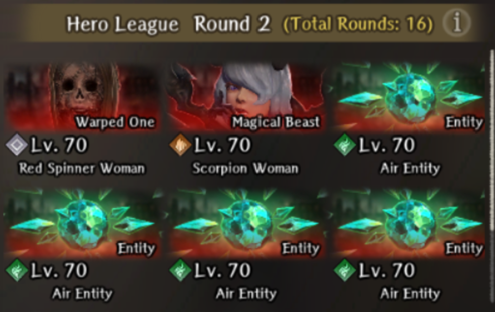{ width="390" }

    === "Enemy Formation"
        - Frontline: Red Spinner Woman 1x, Scorpion Lady 1x
        - Midline: Air Entity 3x
        - Backline: Air Entity 3x

=== "Round 3"

    === "Fight Preview"
        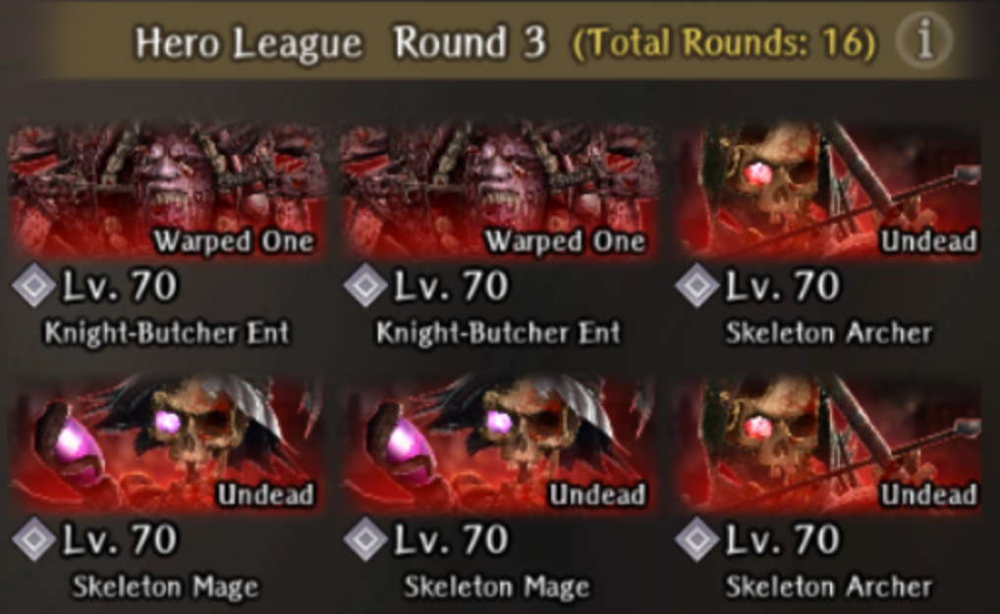{ width="390" }

    === "Enemy Formation"
        - Frontline: Knight Butcher Ent 2x
        - Backline: Skeleton Mage 2x, Skeleton Archer 2x

=== "Round 4"

    === "Fight Preview"
        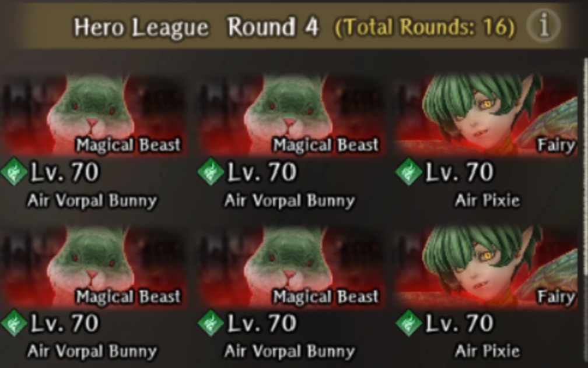{ width="390" }

    === "Enemy Formation"
        - Frontline: Air Vorpal Bunny 4x
        - Backline: Air Entity 2x, Air Pixie 3x

### Adept League

=== "Round 1"

    === "Fight Preview"
        { width="400" }

    === "Enemy Formation"
        - Frontline: Air Vorpal Bunny 2x, Hobgoblin 1x, Green Goblin 2x
        - Midline: Goblin Mage 1x, Goblin Cleric 1x, Goblin Archer 1x
        - Backline: Gluttonous Maw 2x

=== "Round 2"

    === "Fight Preview"
        { width="390" }

    === "Enemy Formation"
        - Frontline: Red Spinner Woman 1x, Scorpion Lady 1x
        - Midline: Air Entity 3x
        - Backline: Air Entity 3x
        
=== "Round 3"

    === "Fight Preview"
        { width="390" }

    === "Enemy Formation"
        - Frontline: Knight Butcher Ent 2x
        - Backline: Skeleton Mage 2x, Skeleton Archer 2x
        
=== "Round 4"

    === "Fight Preview"
        { width="390" }

    === "Enemy Formation"
        - Frontline: Air Vorpal Bunny 4x
        - Backline: Air Entity 2x, Air Pixie 3x

=== "Round 5"

    === "Fight Preview"
        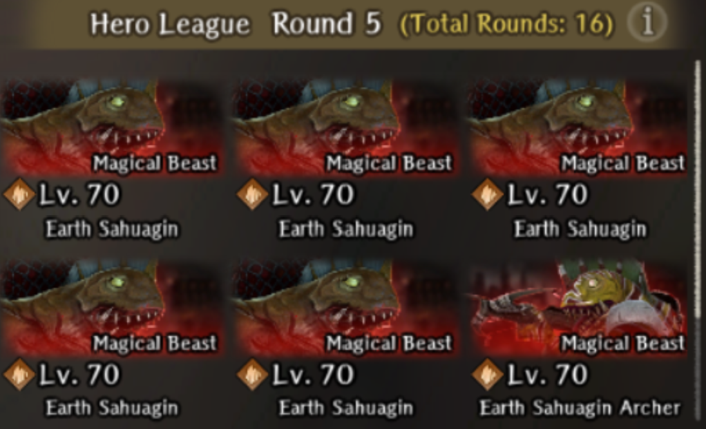{ width="390" }

    === "Enemy Formation"
        - Frontline: Earth Sahuagin 5x
        - Backline: Earth Sahuagin Archer 4x

=== "Round 6"

    === "Fight Preview"
        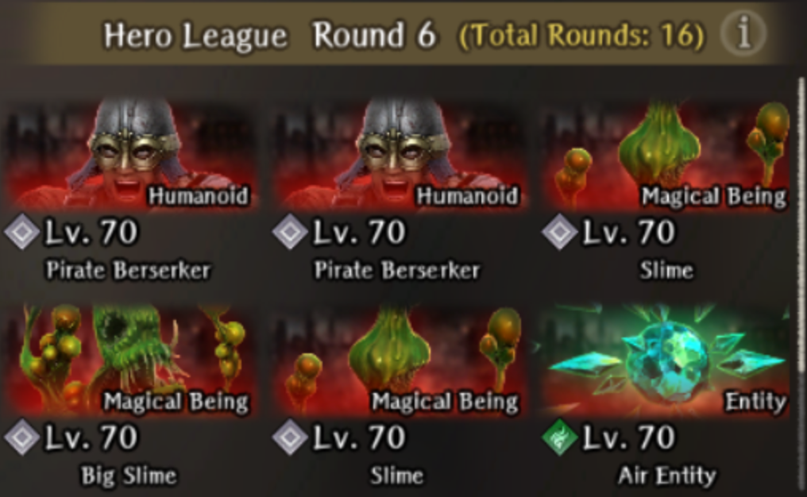{ width="390" }

    === "Enemy Formation"
        - Frontline: Pirate Berserker 2x
        - Midline: Slime 2x, Big Slime 1x
        - Backline: Air Entity 3x

=== "Round 7"

    === "Fight Preview"
        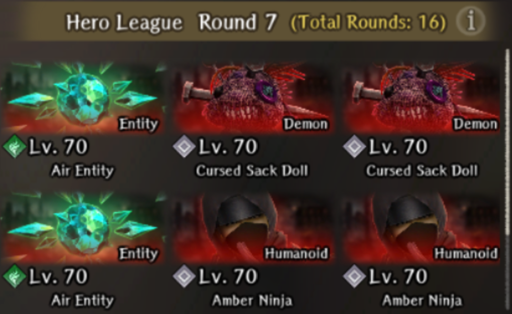{ width="390" }

    === "Enemy Formation"
        - Frontline: Air Entity 2x, Cursed Sack Doll 2x
        - Backline: Amber Ninja 4x

=== "Round 8"

    === "Fight Preview"
        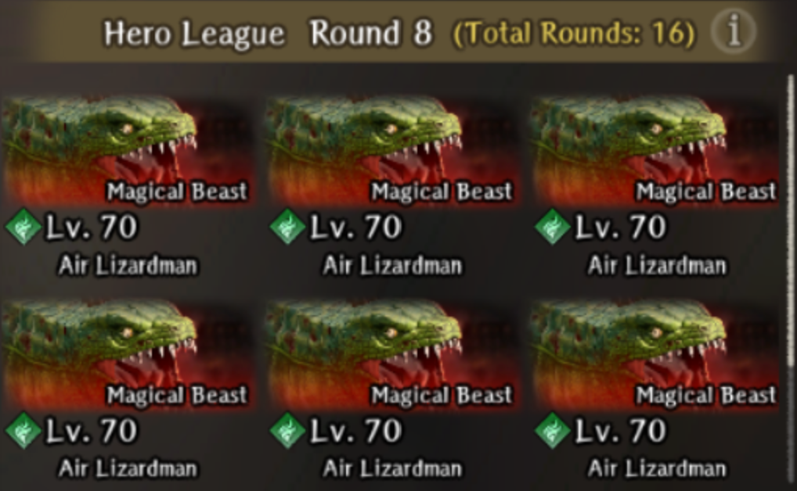{ width="390" }

    === "Enemy Formation"
        - Frontline: Air Lizardman 3x
        - Midline: Air Lizardman 3x
        - Backline: Air Lizardman Champion 3x

### Elite League

=== "Round 1"

    === "Fight Preview"
        { width="400" }

    === "Enemy Formation"
        - Frontline: Air Vorpal Bunny 2x, Hobgoblin 1x, Green Goblin 2x
        - Midline: Goblin Mage 1x, Goblin Cleric 1x, Goblin Archer 1x
        - Backline: Gluttonous Maw 2x

=== "Round 2"

    === "Fight Preview"
        { width="390" }

    === "Enemy Formation"
        - Frontline: Red Spinner Woman 1x, Scorpion Lady 1x
        - Midline: Air Entity 3x
        - Backline: Air Entity 3x
        
=== "Round 3"

    === "Fight Preview"
        { width="390" }

    === "Enemy Formation"
        - Frontline: Knight Butcher Ent 2x
        - Backline: Skeleton Mage 2x, Skeleton Archer 2x
        
=== "Round 4"

    === "Fight Preview"
        { width="390" }

    === "Enemy Formation"
        - Frontline: Air Vorpal Bunny 4x
        - Backline: Air Entity 2x, Air Pixie 3x

=== "Round 5"

    === "Fight Preview"
        { width="390" }

    === "Enemy Formation"
        - Frontline: Earth Sahuagin 5x
        - Backline: Earth Sahuagin Archer 4x

=== "Round 6"

    === "Fight Preview"
        { width="390" }

    === "Enemy Formation"
        - Frontline: Pirate Berserker 2x
        - Midline: Slime 2x, Big Slime 1x
        - Backline: Air Entity 3x

=== "Round 7"

    === "Fight Preview"
        { width="390" }

    === "Enemy Formation"
        - Frontline: Air Entity 2x, Cursed Sack Doll 2x
        - Backline: Amber Ninja 4x

=== "Round 8"

    === "Fight Preview"
        { width="390" }

    === "Enemy Formation"
        - Frontline: Air Lizardman 3x
        - Midline: Air Lizardman 3x
        - Backline: Air Lizardman Champion 3x

=== "Round 9"

    === "Fight Preview"
        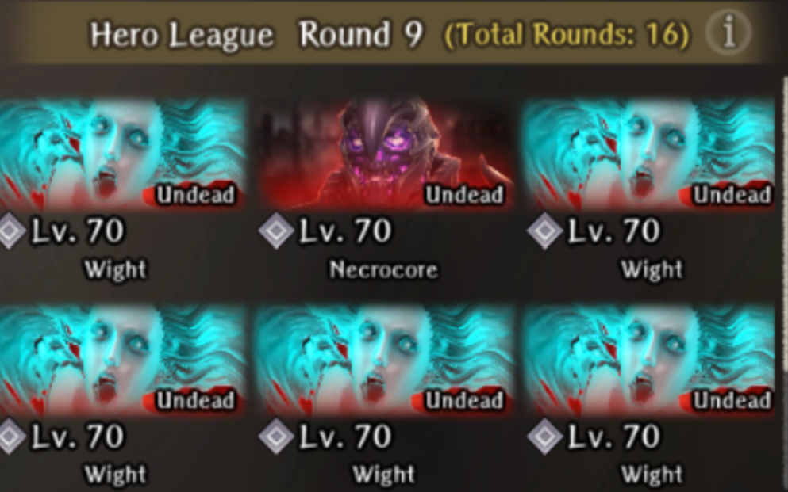{ width="390" }

    === "Enemy Formation"
        - Frontline: Wight 2x, Necrocore 1x
        - Middle: Wight 3x
        - Backline: Sand Apparition 3x

=== "Round 10"

    === "Fight Preview"
        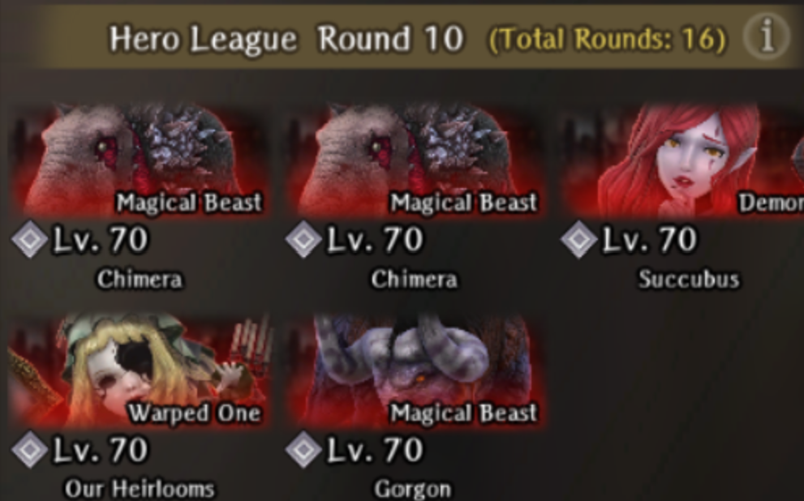{ width="390" }

    === "Enemy Formation"
        - Frontline: Chimera 2x
        - Midline: Succubi 1x, Our Heirlooms 1x
        - Backline: Gorgon 1x

=== "Round 11"

    === "Fight Preview"
        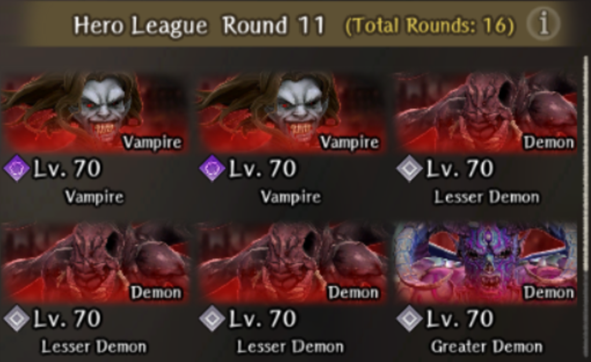{ width="390" }

    === "Enemy Formation"
        - Frontline: Vampire 2x
        - Midline: Lesser Demon 3x
        - Backline: Greater Demon 2x

=== "Round 12"

    === "Fight Preview"
        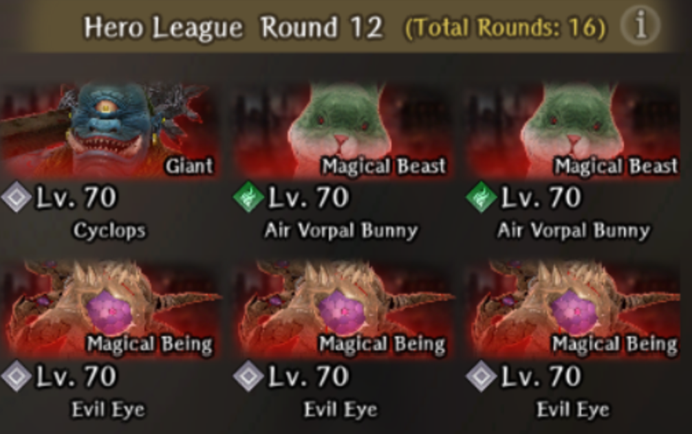{ width="390" }

    === "Enemy Formation"
        - Frontline: Cyclops 1x, Air Vorpal Bunny 2x
        - Backline: Evil Eye 3x

### Hero League

!!! danger "This content is extremely difficult. It's essentially necessary for the player to have Fire Element or Elf Mages with 1H Rods for this content in particular. Due to the nature of magic attacks having very low softcaps especially on 1H weapons, it's not necessary to have very high Mag Power or Div Power. It's better to instead focus on having very high ASPD and possibly even high SUR if possible. It's essentially necessary to also bring Fire Element Knights in order to cover/Knight's Defense for certain rounds, especially with recent buffs to Knight's Defense. It is ideal to have a very high ASPD set specifically for a knight if possible. Samurais with Odachis are not particularly necessary but are more resource efficient due to having both an SP and MP pool. Evasion is not really necessary nor recommended for this league, and status effect spells are typically useless for the vast majority of fights minus a few strategies. For some stat milestones, having 320 ASPD AFTER Fire Element buffs is more than enough to outspeed most high aspd enemies. Aim for at least 650 ATK and 300 MAG on odachi users BEFORE Fire Element buffs. 180 Accuracy and 100 SUR BEFORE Fire Element buffs should be enough for most enemies."

=== "Round 1"

    === "Fight Preview"
        { width="410" }

    === "Enemy Formation"
        - Frontline: Air Vorpal Bunny 2x, Hobgoblin 1x, Green Goblin 2x
        - Midline: Goblin Mage 1x, Goblin Cleric 1x, Goblin Archer 1x
        - Backline: Gluttonous Maw 2x

    === "Tips"
        - Straightforward, recommended to conserve resources.
        - Goblins and Goblin Archers have around 7k HP each.
        - Goblin Mage and Cleric have around 4.5k HP each.
        - Air Vorpal Bunnies have around 5k HP each. They are extremely fast (320 ASPD goes before them).
        - Gluttonous Maws have around 13k HP each.
        - Hobgoblin has around 17k HP.
        - The Goblin Archer will always go first.
        - It is possible to evade most physical attacks here with a dedicated Evasion build besides the Goblin Archer.

=== "Round 2"

    === "Fight Preview"
        { width="410" }

    === "Enemy Formation"
        - Frontline: Red Spinner Woman 1x, Scorpion Lady 1x
        - Midline: Air Entity 3x
        - Backline: Air Entity 3x

    === "Tips"
        - Straightforward, recommended to conserve resources.
        - The Red Spinner Woman has around 12k. It is very fast. (320 ASPD goes before them).
        - Air Entities have around 5k HP each.
        - Scorpion Lady has 35k HP. Can be affected by Sleep, Confuse, Paralysis, Charm, WT Down, and Freeze if needed.
        - It's recommended to deal with the Air Entities first with magic, then use physical attacks/defend for openings for the rest.

=== "Round 3"

    === "Fight Preview"
        { width="410" }

    === "Enemy Formation"
        - Frontline: Knight Butcher Ent 2x
        - Backline: Skeleton Mage 2x, Skeleton Archer 2x

    === "Tips"
        - Straightforward, recommended to conserve resources.
        - Skeletons have around 6k HP each.
        - Butchers have around 30k HP each.
        - Skeleton Archers are very fast and typically one of them will charge up an instant kill arrow. It's recommended to use MAREIN or magic to deal with the skeleton backrow ASAP.
        - Butchers hit very hard but can be affected by opening and are susceptible to status effects, so after dealing with the skeletons, just defend and fish for openings.

=== "Round 4"

    === "Fight Preview"
        { width="410" }

    === "Enemy Formation"
        - Frontline: Air Vorpal Bunny 4x
        - Backline: Air Entity 2x, Air Pixie 3x

    === "Tips"
        - Essentially mandatory to have magic users here. This is the first relatively difficult stage.
        - Bunnies and Entities have around 5k HP each.
        - Air Pixies have around 26k HP each. They are immune to all status effects.
        - The bunnies and pixies are extremely fast (320 ASPD goes before), and Pixies can hit extremely hard. If possible, it's recommended to either have fast mages to cast LA-spells to get rid of all the low HP enemies first OR have a knight to All Around Cover.
        - Pixies will typically cast Masolotu on their allies, and are effectively not hittable with physical attacks besides using Anticipated Attack or using Maces. Sleep Incense may help a bit here to prevent allies from getting sniped by Fairy Arrow. It's recommended to take care of the Pixies after all of the other enemies are defeated with LA-spells.
        
=== "Round 5"

    === "Fight Preview"
        { width="410" }

    === "Enemy Formation"
        - Frontline: Earth Sahuagin 5x
        - Backline: Earth Sahuagin Archer 4x

    === "Tips"
        - Straightforward, recommended to conserve resources.
        - Sahuagin Archers have around 5k HP each, cannot be reasonably evaded, and are extremely fast.
        - Sahuagins have around 11k HP each and can be evaded.
        - A fast knight here would be useful, especially with All Around Cover if possible. Alternatively, fast mages with LA or MA spells can clear the archers, and the sahuagins can be handled with defend/opening/basic attacks.

=== "Round 6"

    === "Fight Preview"
        { width="410" }

    === "Enemy Formation"
        - Frontline: Pirate Berserker 2x
        - Midline: Slime 2x, Big Slime 1x
        - Backline: Air Entity 3x

    === "Tips"
        - Straightforward, recommended to conserve resources.
        - Pirate Berserkers have around 20k HP each.
        - Slimes and Entities have around 5k HP each.
        - Big Slime has 28k HP and is very resistant to physical attacks. It hits extremely hard.
        - All the enemies here are relatively slow. It's recommended to simply deal with the entities and slimes first with magic, and then the rest of the enemies could be handled with defend/opening/single target magic/basic attacks.

=== "Round 7"

    === "Fight Preview"
        { width="410" }

    === "Enemy Formation"
        - Frontline: Air Entity 2x, Cursed Sack Doll 2x
        - Backline: Amber Ninja 4x

    === "Tips"
        - This is another relatively difficult stage.
        - Cursed Dolls have 15k HP each, are somewhat evasive, and cannot reasonably be evaded. They will always go first and are extremely fast (can continually lap you).
        - Ninjas have 7k HP each and typically just cast row magic.
        - Entities have 5k HP each.
        - It's recommended to bring at least one healer here, if not two, as it's possible to get unlucky and have to deal with cleansing Curse from your whole team, as well as setting up Curse incense. The Cursed Dolls can be BATILGREF'd and can be status'd but it is not consistent. It's recommended to cast LA spells to deal with everything else first, then focus on the Cursed Dolls. A knight with Line Cover/Knight's Defense can help protect the front row.

=== "Round 8"

    === "Fight Preview"
        { width="410" }

    === "Enemy Formation"
        - Frontline: Air Lizardman 3x
        - Midline: Air Lizardman 3x
        - Backline: Air Lizardman Champion 3x

    === "Tips"
        - There is referee intervention here for Humans. It's recommended to cleanse the three debuffs ASAP or risk taking too much damage.
        - Lizardman Champion here is extremely fast and will cast Assault command repeatedly until at least 3 Lizardman die. It has around 69k HP. It cannot reasonably be evaded. It does extremely high damage frequently and typically use AOE attacks.
        - Lizardman have around 21k HP each. They are susceptible to status effects and can be reasonably evaded.
        - Bring magical beast resist gear for this if possible. A recommended strategy is to sleep/freeze two rows of Lizardman, then kill two of them to move the Champion to the 2nd row. Magical Beast weapons such as spears/bows should be used to focus on killing the Champion before killing the rest.

=== "Round 9"

    === "Fight Preview"
        { width="410" }

    === "Enemy Formation"
        - Frontline: Wight 2x, Necrocore 1x
        - Middle: Wight 3x
        - Backline: Sand Apparition 3x

    === "Tips"
        - Wights have around 7k HP each. They are very annoying due to possibility of casting MP drain.
        - Necrocore has around 39k HP. Can be opening'd. It is pretty weak and doesn't do much. Only real threat is the instant kill.
        - Sand Apparitions have around 16k HP each. These are the main threat of this stage due to Sandstorm possibly doing a lot of AOE damage. Otherwise, they mainly cast BATILGREF.
        - It's recommended to cast LA spells to get rid of the Wights ASAP, then deal with the Sand Apparitions after with ranged attacks/melee attacks when they move up/magic. The Necrocore is low priority to deal with.

=== "Round 10"

    === "Fight Preview"
        { width="410" }

    === "Enemy Formation"
        - Frontline: Chimera 2x
        - Midline: Succubus 1x, Our Heirlooms 1x
        - Backline: Gorgon 1x

    === "Tips"
        - Straightforward, recommended to conserve resources.
        - The Chimeras have around 23k HP each.
        - Our Heirlooms has around 53k HP.
        - Succubus has around 5k HP.
        - Gorgon has around 22k HP.
        - It's recommended to bring a healer to immediately put down manipulation incense. The succubus needs to be killed ASAP as it can potentially drain SP/MP. Petrification incense can be put down after. Rest of enemies can be dealt with normally/opening defended.

=== "Round 11"

    === "Fight Preview"
        { width="410" }

    === "Enemy Formation"
        - Frontline: Vampire 2x
        - Midline: Lesser Demon 3x
        - Backline: Greater Demon 2x

    === "Tips"
        - Vampires have around 22k HP each. Not immune to status effects but very low chance.
        - Lesser Demons have around 9k HP each. They only cast weak single target magic.
        - Greater Demons have 55k HP each. Their Powerful Arm attack does a lot of damage. They also can cast full team Confusion like the greater sealed demon. They can be frozen (low chance) and BATILGREF'd (not consistent). Otherwise immune to everything else.
        - Bring demon resist gear if possible. It's recommended to bring a healer to put down manipulation incense immediately, and then possibly sleep incense while dealing with the vampires. Vampires need to be dealt with first, but be careful not to bring their HP too low as Vampire Bats does a lot of damage. It might be favorable to keep the Greater Demons in the row behind lesser demons to reduce their damage.
        
=== "Round 12"

    === "Fight Preview"
        { width="410" }

    === "Enemy Formation"
        - Frontline: Cyclops 1x, Air Vorpal Bunny 2x
        - Backline: Evil Eye 3x

    === "Tips"
        - Cyclops has around 90k HP and is immune to status effects and BATILGREF. 
        - Vorpal Bunnies have around 5k HP each.
        - Evil Eyes have around 12k HP each and have two actions per turn.
        - There is referee intervention for Beastfolk.
        - It's recommended to bring a Knight for this for Knight's Defense/cover as well as 3 Mages for this to blow up the Evil Eyes ASAP. The Cyclops can be dealt with last as it's just a giant sponge (that hurts if he high rolls his damage).

=== "Round 13"

    === "Fight Preview"
        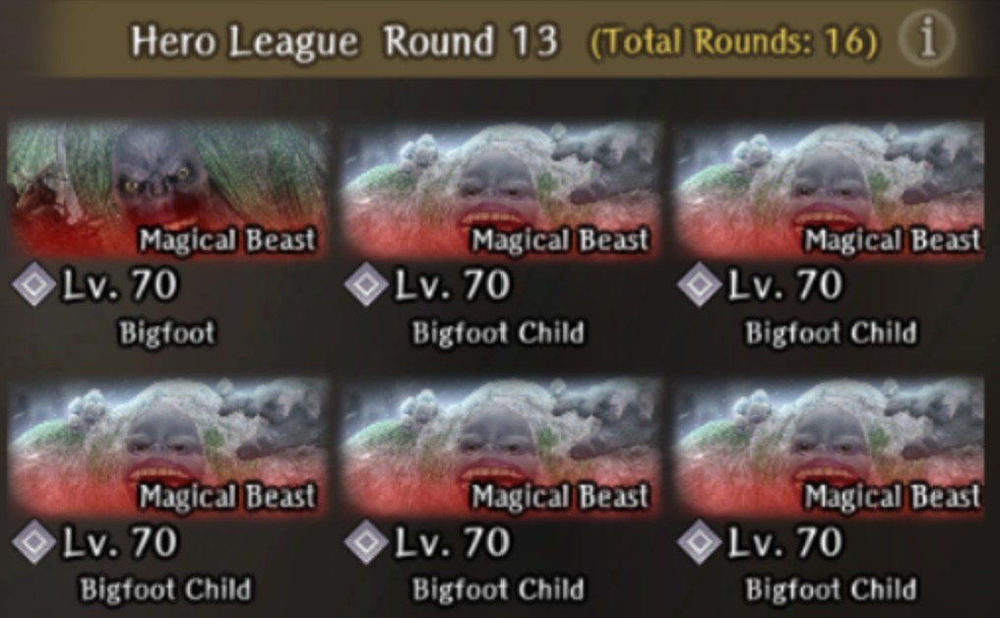{ width="410" }

    === "Enemy Formation"
        - Frontline: Bigfoot, Bigfoot Child 2x
        - Backline: Bigfoot Child 3x

    === "Tips"
        - Bigfoot Children have around 10k HP each. They're extremely fast (320 ASPD goes before), and can do a lot of damage.
        - Bigfoot has 50k HP and typically just spams Horrendous Breath.
        - It's recommended to have a very fast knight to All Around Cover immediately OR several very fast mages to immediately blow up the Bigfoot Children with LA spells. Healers can then just put down Stun/Paralysis Incenses to deal with the breath and then kill the Bigfoot.

=== "Round 14"

    === "Fight Preview"
        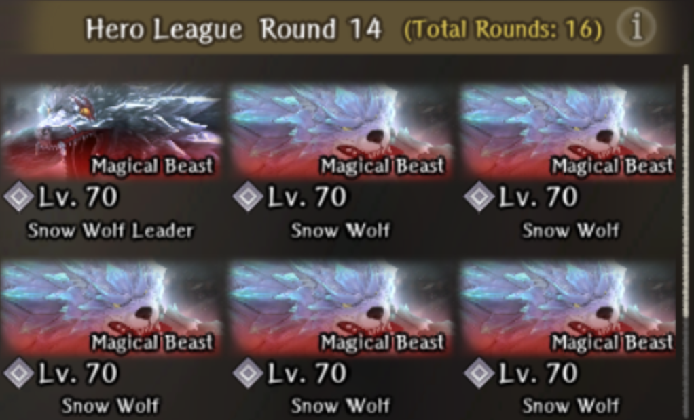{ width="410" }

    === "Enemy Formation"
        - Frontline: Snow Wolf Leader 1x, Snow Wolf 3x
        - Backline: Snow Wolf 4x

    === "Tips"
        - Snow Wolf Leader has around 69k HP. It is extremely fast (320 ASPD will go before). It also hits extremely hard.
        - Snow Wolves have around 7k HP each. They will typically summon other wolves and/or buff all wolves.
        - Bring magical beast resist gear if possible. It's recommended to simply kill all the Snow Wolves with LA spells before they go and then have a Knight reduce the Snow Wolf Leader's damage/cover for allies. A healer to cleanse chill/freeze is also recommended but not necessary.

=== "Round 15"

    === "Fight Preview"
        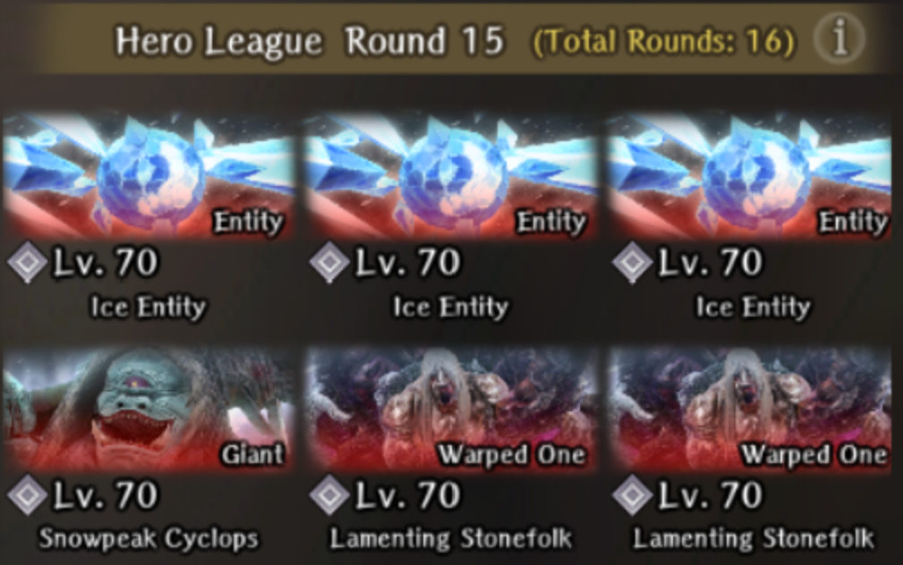{ width="410" }

    === "Enemy Formation"
        - Frontline: Ice Entity 3x
        - Midline: Snowpeak Cyclops 1x
        - Backline: Lamenting Snowfolk 2x

    === "Tips"
        - Ice Entities have around 10k HP each and are very fast (320 ASPD unit goes before). They just cast DALTO and MADALTO.
        - Lamenting Snowfolk have around 23k HP each and also prioritize casting DALTO.
        - Snowpeak Cyclops has around 54k HP. As expected, it hits extremely hard after concentration. It is also effectively immune to status effects. BATILGREF can apply at a very low chance.
        - It's recomended to use LA-spells to deal with the entities ASAP and then focus on the Lamenting Snowfolk before attempting to kill the Snowpeak Cyclops in one turn before it concentrates with multiple defense buffs. If you're unable to do so, then bring multiple units that can cast Dissipation/Malefic Wind.

=== "Round 16"

    === "Fight Preview"
        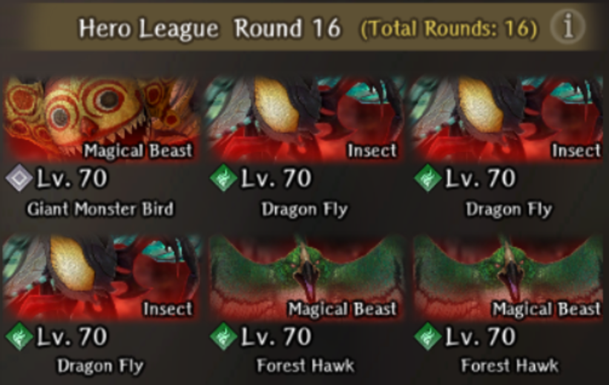{ width="410" }

    === "Enemy Formation"
        - Frontline: Giant Monster Bird 1x, Dragonfly 2x
        - Backline: Dragonfly 1x, Forest Hawk 2x

    === "Tips"
        - Dragonflies have 9k HP each.
        - Forest Hawks have 18k HP each.
        - Giant Monster Bird has 178k HP. It is immune to all status effects, and extremely resistant to debuffs. It also cannot be evaded. It will typically cast either Stone Breath, Trample, or Wing Buffet. Stone Breath always does 1 dmg, Trample can hit upwards of a couple thousand damage, and Wing Buffet will deal minor damage while delaying all that is hit.
        - It's recommended to have mages deal with the Dragonflies and Forest Hawks ASAP with LA spells. Knight should constantly keep KD up if possible. It's a little bit more efficient if the Knight has low ASPD as Wing Buffet will keep pushing their turn back, thus making KD last longer. After that it's simply a DPS race between the Bird and your SP/MP pools.
        

