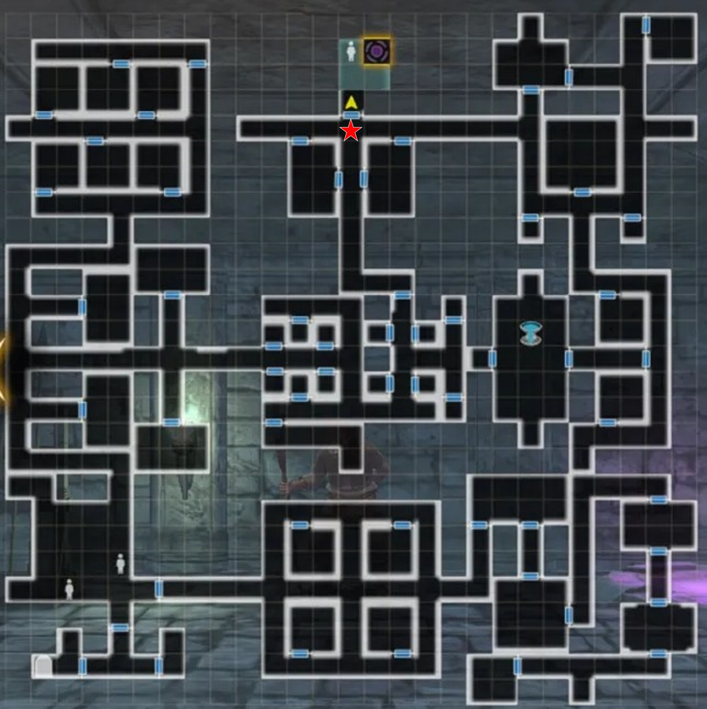
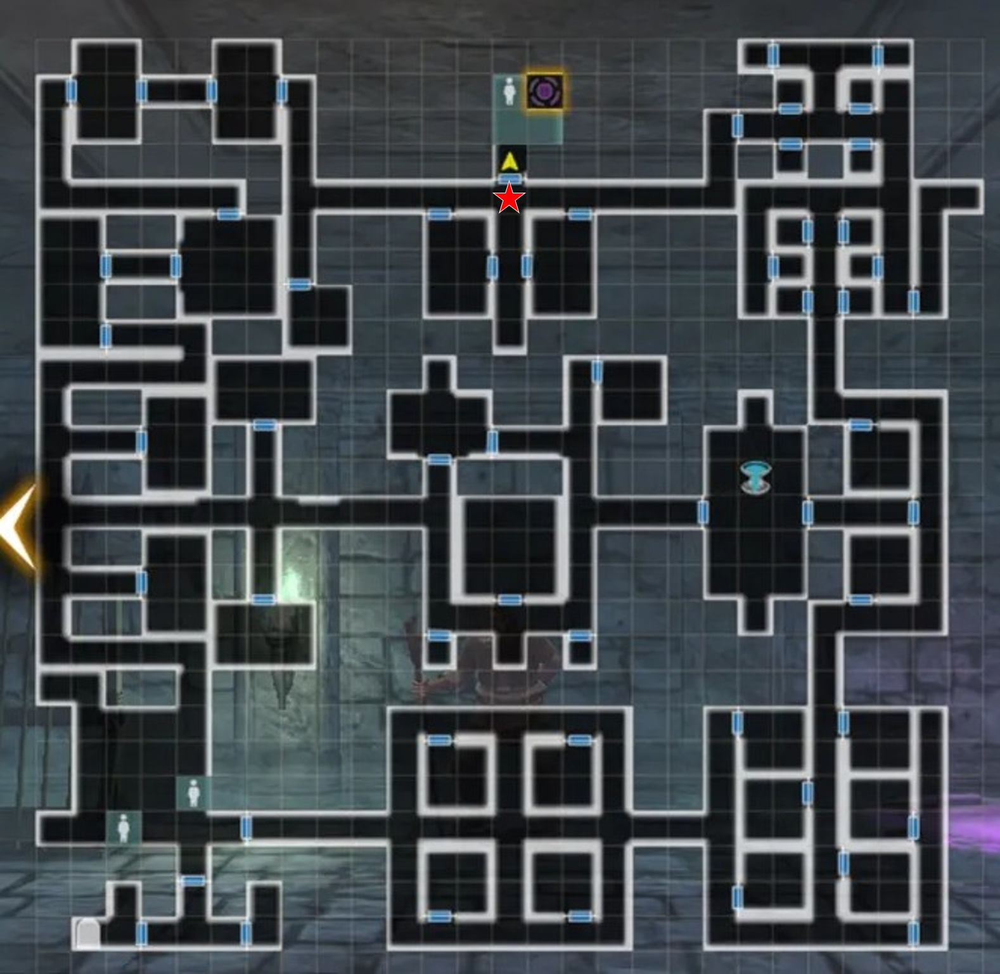
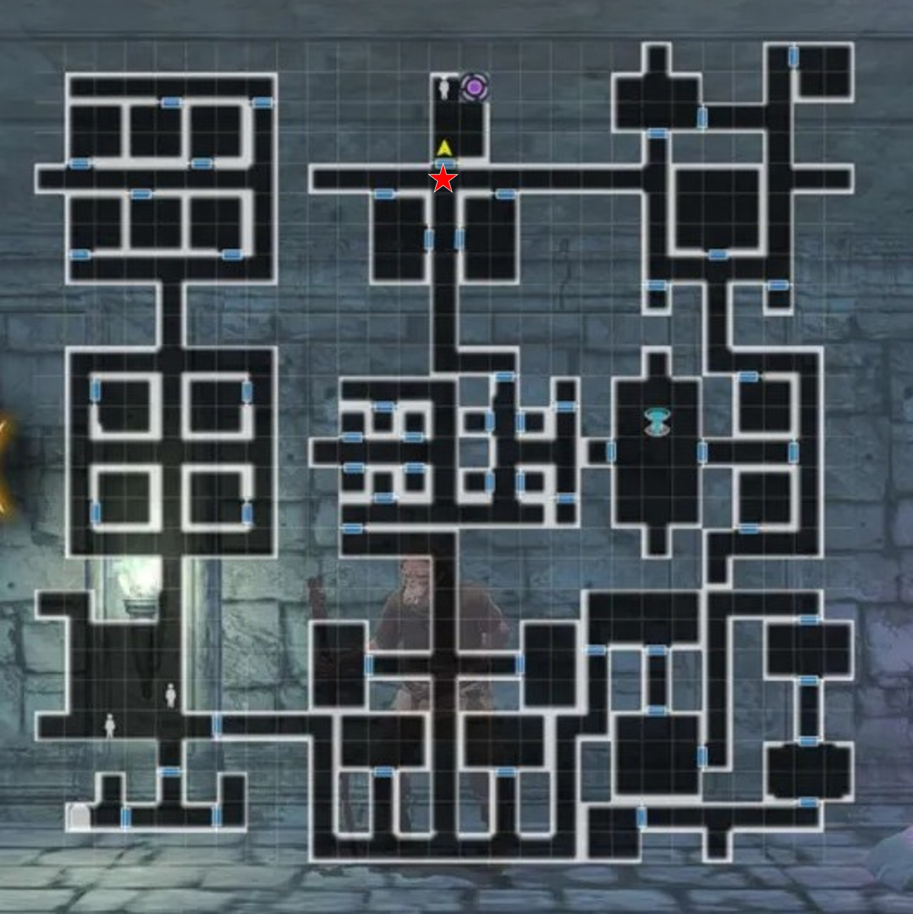
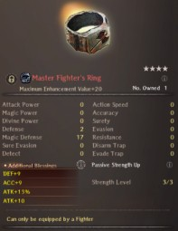

# Fighter Trials

## Trials Introduction
After progressing sufficiently, you will be invited to participate in various Class trials to prove your worth. These Trials are almost all the same, and require navigating a maze, defeating some enemies, and a floor boss. Each trial has Beginner, Intermediate, and Advanced levels. Enemies typically follow those found in the 1st, 2nd, and 3rd abysses accordingly.

Trials can only be entered by a parties of up to three adventurers (including the MC), and they must be of the same class as the trial (the MC can be a Wanderer if either you have not unlocked that class change or simply prefer the MC go in with fighter-like stats). 

You will get a notification in the Royal Capital when any Class Trials became available to you.  Accept the request at the guild starting with the Beginner Trial in the Featured tab. This will mark the location on your map.  After completing Beginner, you accept Intermediate and Advanced the same way.

Each trial will have a separate Special Exchange of rewards available from the Jeweler.  Completing each Trial level gives a certain number of Seals (Exchange currency). You obtain a total of 600 Seals of the Fighter by completing all three levels, which will completely empty the Exchange. You cannot farm additional currency. 

Trials all provide a unique Class-specific Ring.  See [Rewards](#rewards).

There are no missions for Trial events.

## Guide:

Each Fighter Trial level requires you to complete three tasks:  

1. Defeat a number of wandering monsters (number increases for each level)
2. Defeat a miniboss adventurer (located at the entrances to the fountain)
3. Defeat the boss

Finally *you must talk to the NPC in the room after the boss* to register completion and receive your completion reward.  Then you can teleport back to the start and leave.

### Maps

There are several map variations, 4 of which are shown below, and are random upon entering. It is not necessary to explore the whole map, you simply need to make it to the end and defeat the floor boss. Again, it only counts as a clear upon talking to the old man with the mask beside the portal. If you leave without talking to him you will have to repeat the trial. There is a fountain that is guarded by a Benjamin-NPC on each side.

*Note in Variation #2, the only path to the Fountain is by going past the Boss, which requires going through the room to the southeast.*

??? "Maps"  
    === "Map Variation 1"  
          

    === "Map Variation 2"  
          

    === "Map Variation 3"  
          

    === "Map Variation 4"  
          

??? note "Tips"
    - Remember to carry potions on all three characters.
    - Carry a healing staff switch so you can use healing spells from the MC and/or other characters who have access to dios/madios. Consider using Self-Healing as well with a divine staff.
    - The enemies on the advanced floor consist of Minotaurs, Lesser Demons, and Chimeras.

??? danger "Intermediate Difficulty Fight Tips"
    - The final enemy is always a Minotaur. It has around ~7.5k HP. It has no element, and is affected by Magical Beast Slayer,
    - The Minotaur has a set order of actions. It will do nothing on Turn 1, 2 turn Defense buff on Turn 2, 10 turn Accuracy buff on Turn 3, 10 turn Attack buff on Turn 4, then begin attacking on turn 5 onwards with a CT down skill and Row-switching skill.
    - Katino and Kantios are effective but not guaranteed on the Minotaur.
    
??? danger "Advanced Difficulty Fight Tips"
    - The final enemy is always a Vampire. He has around ~7k HP. Vampires are dark element, and is affected by Vampire Slayer.
    - He will generally just basic attack that can be consistently dodged with 150~ evasion. Alternatively he may cast Zelos
    - He is susceptible to openings, which will inflict around 1k damage
    - He will cast Kaltu on himself at around half HP (~3.5k HP). When he is at low HP (~1k HP) he will do a 1 time Vampire Bats skill that inflicts very high damage. He will heal for about 10x of what the vampire bats hit on you.
    - It's recommended to try to chip him down to a point where you can finish him off in one turn with Full Power Strike from all 3 fighters.

    ??? note "Efficient Strategy for Vampire Slaying"
        Assuming you have three fighters that are able to deal 1k+ damage per hit with FPS, you can easily kill the vampire in 6 turns using the following strategy. Buy some Scrolls of Shared Power from the shop if you want to try this.

        - Turn 1: Use MORLIS, Armor Break, and Scroll of Shared Power
        - Turn 2: Use FPSx3
        - Turn 3: Smack the Vampire for 3k+ damage. He'll use KALTU.
        - Turn 4: Use MORLIS, Armor Break, and Scroll of Shared Power. Note that if the Vampire is faster than one or two of your party members, use BATILGREF instead of MORLIS this turn
        - Turn 5: FPSx3
        - Turn 6: Smack the Vampire for 3k+ damage. Around the first or second hit, he'll yell at you in Japanese. As long as your party all acts before he does next (thus the conditional BATILGREF), you'll kill him before he can bat you.

## Rewards
??? note "Master Fighter Ring"  
      
    
    The Fighter ring is always 4* Red and has fixed stats. Full Alter Stones can reroll the values but not the actual stat lines.  
    See [Blacksmithing FAS example](/equipment/blacksmithing.md#master-fighters-ring-example)

