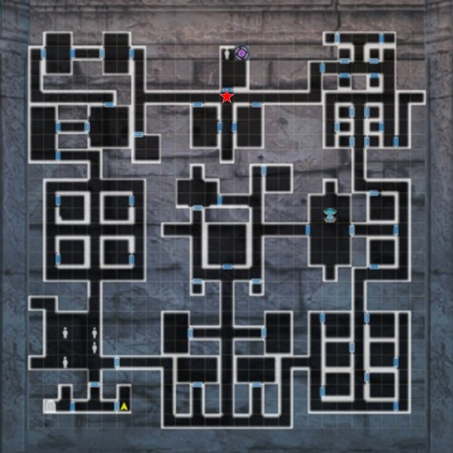
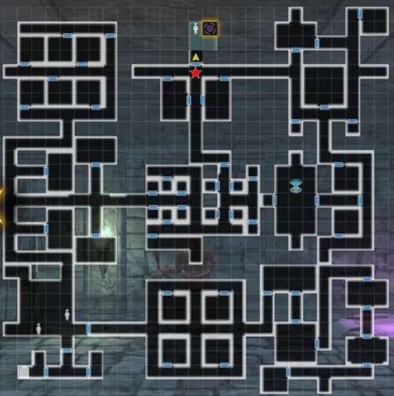
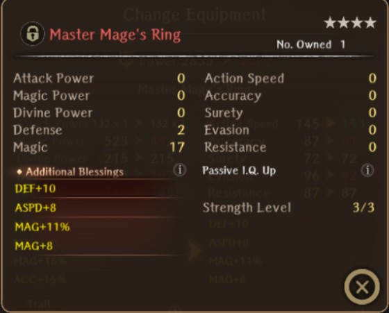

# Mage Trials

## Requirement
After sufficient story progress you will be invited to participate in various Class trials to prove your worth.  You will get a notification in the Royal Capital when a Class Trial becomes available to you.  Accept the request at the guild starting with the Beginner Trial in the Featured tab. This will mark the location on your World Map.  After completing Beginner, you accept Intermediate and Advanced the same way.

## Trials Introduction

- Trials can only be entered by a parties of up to three adventurers (including the MC), and they must be of the same class as the trial (the MC can be a Wanderer if either you have not unlocked that class change or simply prefer the MC go in with fighter-like stats). 

- These Trials are almost all the same, and require navigating a maze, defeating some enemies, and finally a floor boss. Each trial has Beginner, Intermediate, and Advanced levels. Enemies typically follow those found in the 1st, 2nd, and 3rd abysses accordingly.

- Each trial will have a separate Special Exchange of rewards available from the Jeweler.  Completing each Trial level gives a certain amount of Exchange currency (Seals). Completing all three levels will earn 600 Seals which is enough to completely empty the Exchange. You cannot farm additional currency. Trials all provide a unique [Class-specific Ring](#rewards).

## Guide:

Each Mage Trial level requires you to complete two tasks:  

1. Defeat a number of wandering monsters (number increases for each level)
2. Defeat the boss

Finally *you must talk to the NPC in the room after the boss* to register completion and receive your completion reward.  Then you can teleport back to the start and leave.

### Maps

There are several map variations, 4 of which are shown below, and are random upon entering. It is not necessary to explore the whole map, you simply need to defeat the necessary enemies and the floor boss located in front of the door to the portal room. Again, if you leave without talking to the Master you will have to repeat the trial. There is a fountain that is guarded on each side. It is recommended you clear all tasks except the boss and then rest for the boss fight.

*Note in Variation #2, the only path to the Fountain is by going past the Boss, which requires going through the room to the southeast.*

??? "Maps"  
    === "Map Variation 1"  
        {width="450"}  

    === "Map Variation 2"  
        {width="450"}    

    === "Map Variation 3"  
        {width="450"}    

    === "Map Variation 4"  
        {width="450"}    

??? note "Tips"
    - Remember to carry potions on all three characters.
    - Carry a healing staff switch so you can use healing spells from the MC and/or other characters who have access to dios/madios. 
    - Normal enemies typically have less than 550 HP in all stages of the map. You can usually blow them up with one or two LA- spells. The hobgoblin tends to have quite a bit more hp, but nothing crazy.
    - All the enemies are very resistant to physical damage (they only take 1 damage).

??? danger "Beginner Boss Fight Tips"
    - This fight consists of two Fire element Hobgoblins with around 1.5k HP each.

??? danger "Intermediate Boss Fight Tips"
    - This fight consists of a Scorpion Lady with two Wind element Vorpal Bunnies in the front row, and two Fire Element Clouds in the back row.
    - Every enemy besides the Scorpion Lady has a little over 500 HP.
    - The Scorpion Lady herself has around 2-3k HP. When she reaches a certain HP Threshold, she will instantly cast her charge skill, which can be evaded.

??? danger "Advanced Boss Fight Tips"
    - This fight consists of a Pixie and a Chimera. The Pixie has 2-3k HP. The Chimera has 5-6k HP. When the Pixie dies, the Chimera gains a permanent ATK UP and ACC Up buff. If the Chimera is killed first, the Pixie will spam Charm on your team.
    - At a certain HP threshold, the Chimera will cast an attack that hits extremely hard (over 700) when it has the ATK UP buff.
    - At a certain HP threshold, the Chimera will buff again?

??? note "Master Mage's Ring"
    
    - The Mage ring is always 4* Red and has fixed stats when using a FAS. The values can be rerolled but not the type of stat lines.
