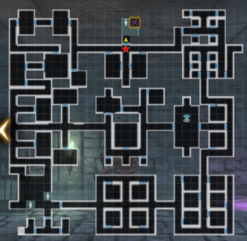
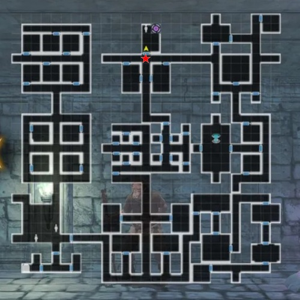
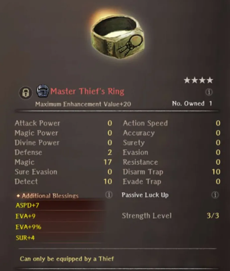

# Thief Trials

## Requirement
After sufficient story progress you will be invited to participate in various Class trials to prove your worth.  You will get a notification in the Royal Capital when a Class Trial becomes available to you.  Accept the request at the guild starting with the Beginner Trial in the Featured tab. This will mark the location on your World Map.  After completing Beginner, you accept Intermediate and Advanced the same way.

## Trials Introduction

- Trials can only be entered by a parties of up to three adventurers (including the MC), and they must be of the same class as the trial (the MC can be a Wanderer if either you have not unlocked that class change or simply prefer the MC go in with fighter-like stats). 

- The Thief Trial is unique:  There are no wandering enemies, only chests to disarm. There is still a boss to defeat. There are still Beginner, Intermediate, and Advanced levels.  

- The Thief Trial has a separate Special Exchange of rewards available from the Jeweler.  Completing each Trial level gives a certain amount of Exchange currency (Seals). Completing all three levels will earn 600 Seals which is enough to completely empty the Exchange. You cannot farm additional currency. Trials all provide a unique [Class-specific Ring](#rewards).

## Guide:

Each Thief Trial level requires you to complete two tasks:  

1. Find and disarm a certain number of chests (number increases for each level, failing a chest reveals a mimic)
2. Defeat the Mimic boss is the final chest

Finally *you must talk to the NPC in the room after the boss* to register completion and receive your completion reward.  Then you can teleport back to the start and leave.

### Maps

There are several map variations, 4 of which are shown below, and are random upon entering. It is not necessary to explore the whole map, you simply need to unlock the required number of chests and defeat the floor boss located in front of the door to the portal room. Again, if you leave without talking to the Master by the portal you will have to repeat the trial. There is a fountain you can use to replenish HP/SP/MP if you failed any chests. It is recommended you clear all tasks except the boss and then rest for the boss fight.

*Note in Variation #2, the only path to the Fountain is by going past the Boss, which requires going through the room to the southeast.*

!!! note "All the maps here are the same as that of the Fighter/Mage Proving Grounds."

!!! warning "If you fail the boss fight and Rise Again you will respawn on the chest and must step off and on again to retry the fight.  You can step north through the door into the final room and talk to the Master Thief/use the teleporter, but without having killed the mimic you will fail the Trial."

??? "Maps"  
    === "Map Variation 1"  
        {width="450"}  

    === "Map Variation 2"  
        {width="450"}    

    === "Map Variation 3"  
        {width="450"}    

    === "Map Variation 4"  
        {width="450"}    

??? note "Tips"
    - Chests are static throughout the map variations and difficulties (They are in the same spots at every same map tile, but tiles can move)
    - Remember to carry potions on all three characters.
    - Carry a healing staff so you can use healing spells from the MC and/or other characters who have access to dios/madios. Consider using Self-Healing as well with a divine staff.
    - Trap difficulty is similar to harder chests in the 1st, 2nd, and 3rd Abyss, respectively. Disarm around 60 is manageable on Beginner Traps, around 130 on Advanced.  
    - The boss fights are all mimics and cannot be avoided.  
    
??? danger "Beginner Difficulty Fight Tips"
    - It's a normal mimic. It will always go first with "Sudden Attack" dealing a small amount of damage (~150-200HP).  
    - It almost always targets the least evasive front row character.  
    - It has very little HP but cannot be suretied.  
    - It is highly susceptible to Poison type attacks and Poison Damage.  
    - High enough evasion (>100) can avoid almost all attacks after the initial attack.  
    - Evasion boosting gear, hiding, evasion boost spells, and defending can ride out the fight while Poison does all thr work. 

??? danger "Intermediate Difficulty Fight Tips"
    - It's a normal mimic. It will always go first with "Sudden Attack" dealing a decent amount of damage (300-400HP)  
    - It almost always targets the least evasive front row character.  
    - It has very little HP but cannot be suretied.  
    - It is highly susceptible to Poison type attacks and Poison Damage.  
    - High enough evasion (>150) can avoid almost all attacks after the initial attack.  
    - Evasion boosting gear, hiding, evasion boost spells, and defending can ride out the fight while Poison does all thr work. 

??? danger "Advanced Difficulty Fight Tips"
    - It's a gold mimic. It will always go first with "Sudden Attack" dealing a decent amount of damage (500+ HP).
    - It almost always targets the least evasive front row character.  
    - It does not take any damage from any sources besides Poisoning it. In fact, it will take extremely large amounts of damage when poisoned. It's recommended to use Poison Berry after poisoning it normally.  
    - It can also be bled with Blood Edge.  
    - It is immune to all other debuffs/CC.  
    - High enough evasion (>200) can avoid almost all attacks after the initial attack.  
    - Evasion boosting gear, hiding, evasion boost spells, and defending can ride out the fight while Poison does all thr work. 

??? tip "Sacrificial Lamb Strategy"  

    - Under-leveled parties are more than capable of completing all Thief Trials as long as you can disarm the traps and stack enough EVA on one character.  You do however, have to survive the first round boss mimic attack. 
    - One approach is to bring two thiefs with the MC. On thief has all your best EVA gear stacked on them in the front row.  The MC goes behind that thief.  The third thief goes at the front in a different column.  
    - The mimic will very likely attack that low EVA thief.  If they die, don't revive them and risk paralyzing the MC. That thief will likely just be killed again the next round anyway. The high EVA front thief hides. The MC casts MASOLOTU on the front row if he has it, or hides as well.  Assuming the mimic misses the EVA thief, the front thief just defends and keeps hide up. The MC does poison attacks/poison berry and renews any buffs.  If a stray attack gets through, defending hopefully keeps it survivable, and you can heal/rehide. Continue until poison kills the mimic.
    
??? note "Master Thief Ring"
    
    - The Thief ring is always 4* Red and has fixed stats. Full Alter Stones can reroll the values but not the actual stat lines.

