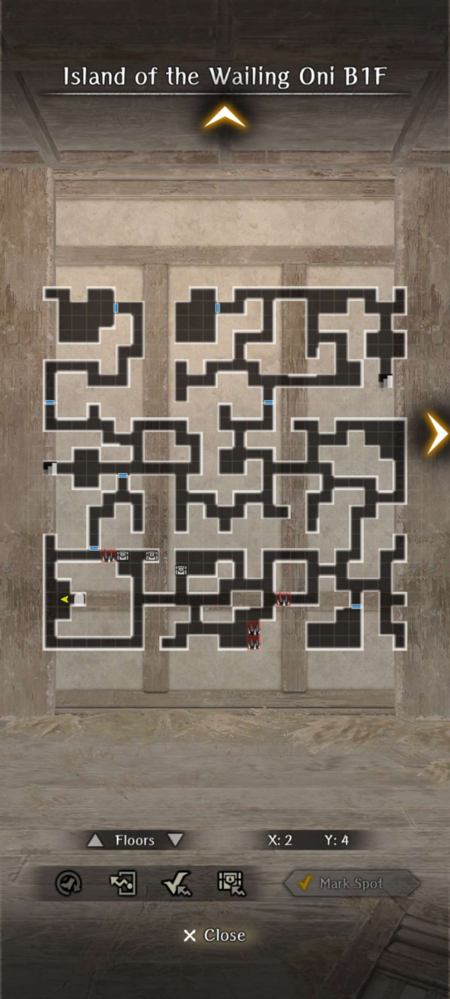
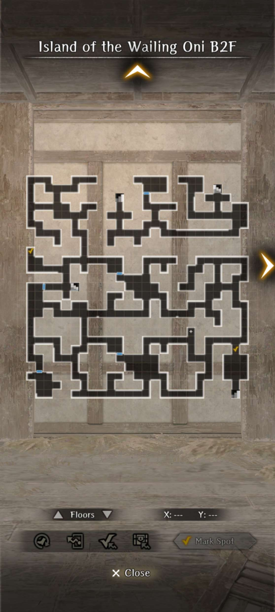
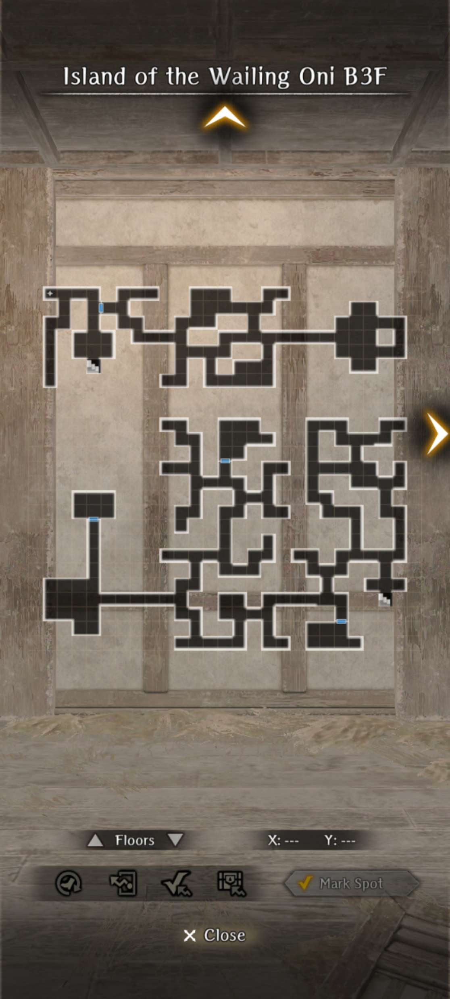
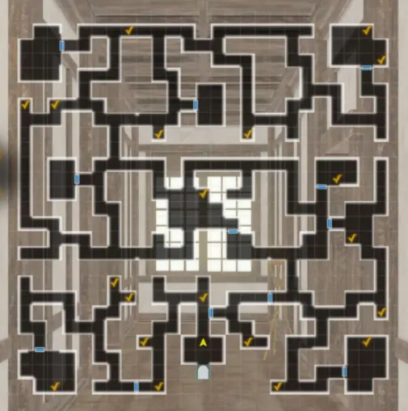
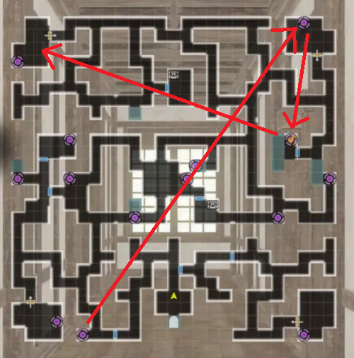
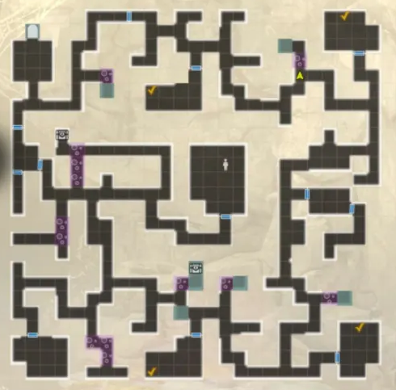
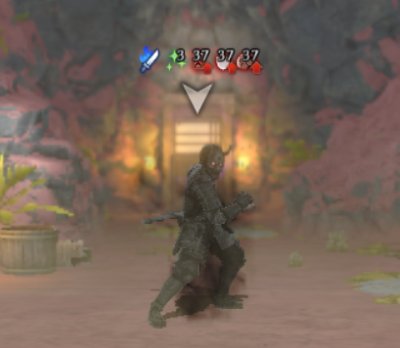

# Vendetta on the Island of the Wailing Oni 

!!! item "This event is permanently available."

## Unlock Conditions

- First part requires reaching Route 5 of Abyss 4.
- Second part requires having cleared a bad ending of Abyss 4 and completing the first part.

## Overview

??? note "How to Accept the Request" 

    - Request is located at the Royal Capital Luknalia in the Adventurer's Guild > Requests > Featured > "Recovery of Oni Treasure".
    - Head to Port Town Grand Legion from the world map after accepting the request. Talk with the sailor in town and 'board the ship'.
    - You can leave and re-enter from the world map at any time. 'Island of the Fire Oni' is east of Port Town Grand Legion.

!!! warning "MC Getting killed by the Fire Oni at the end of B3F within your first run will completely reset your request." 

## Guide for Island of the Wailing Oni (First Part)

!!! note "1st Run"

    === "Guide"
        - Enter B1F and interact with the Samurai. Help him, as he is necessary for progression. Give him a Medicinal Herb (It will pull from town storage) or Dried Abalone. It doesn't matter which. Afterwards, take western stairs to the next floor.
        - On B2F, head to the southern middle region and pick up the letter from a dead samurai. Have Kanosuke read it and ask for his help. Continue onwards east. There is a Minotuar and two Lesser Demon miniboss fight just before the stairs to B3F. 
        - On B3F, head to the bottom left room to fight the Red Oni final boss. If you helped Kansouke he will slay the boss when its has low health. 
        - Ignore the new Red Oni and pick up a key in the center of the boss room. Open the locked room in northern B3F and read the journal on the shelf for key knowledge. 
        - The request cannot be completed any further so use the Cursed Wheel to reset the request.
        
    === "Red Oni Boss Fight Details"
    
        - ~35k health. Spawns with 2 Red Hobgoblins with ~2k health in the same row. 
        - Is Fire Element and uses fire elemental attacks.
        - Has very high accuracy (over 300).
        - Boss periodically summons new Red Hobgoblin out of turn. Red Hobgoblin will charge an attack out of turn that, cleaving front row.
        - Boss action Blazing Strike is a front-row single target attack that deals 1400-1700 Fire Damage, ignoring armor. Healer/Knight/water resistance highly recommended. Alternatively, put MC in back row and just reverse the occasional deaths.
        - Acts twice often, very high chance of using one action to summon a Red Hobgoblins if one is dead.
        - Can be Crit. Can be delayed. Batilgref recommended.
        - Scripted end of fight at 20% boss health if Kanosuke was saved.
        
!!! note "2nd Run"

    === "Guide"
    
        - Take the request from the guild once again and reach the island through Port Town. Save Kanosuke from hunger and give him the letter you previously obtained. Mention the growing of horns. He will now follow you and help you read foreign text throughout the dungeon.
        - On B1F Head to the Archive Room (top left locked room). It will be locked but Kanosuke tells you to search for a hidden clue. The clue will be on B2F at westernmost wall (X:1, Y:17). With clue obtained, Kanosuke will then mark the key's location on your map with an exclamation mark on the same floor (X:18, Y:13). 
        - Head back to the Archive Room and read all the texts on the shelves. You will find out you need to stop the Oni transformation through the shrine on the alternate section of B3F.
        - Take the northeast stairs on B1F and follow the path to the Shrine to northeastern B3F. 
        - After reaching interacting with the shrine, you learn you need to repair it with paper seals (found in top left locked room of B1F), and salt from the Pantry (bottom left room of B2F). Head back to the shrine and let Kanosuke fix the shrine.
        - Head to the boss room and fight the Oni again. Upon winning, head to the middle locked room on B3F and read the diary. Head back to the Oni boss room and go into the treasure room to receive Kansouke as a bondmate (Bind Tolerance), a gold statue for the request, and a request to deliver a letter to his Samurai Dojo.
        
    === "Red Oni Boss Fight Details"
    
        - ~35k health. Spawns with 2 Red Hobgoblins with ~2k health in the same row. 
        - Is Fire Element and uses fire elemental attacks.
        - Has very high accuracy (over 300).
        - Boss periodically summons new Red Hobgoblin out of turn. Red Hobgoblin will charge an attack out of turn that, cleaving front row.
        - Boss action Blazing Strike is a front-row single target attack that deals 1400-1700 Fire Damage, ignoring armor. Healer/Knight/water resistance highly recommended. Alternatively, put MC in back row and just reverse the occasional deaths.
        - Acts twice often, very high chance of using one action to summon a Red Hobgoblins if one is dead.
        - Can be Crit. Can be delayed. Batilgref recommended.
        - Scripted end of fight at 20% boss health if Kanosuke was saved.
        
         

## Maps

??? map "B1F"
    

??? map "B2F"
    

??? map "B3F"
    

## Guide for Rock-Heart Style Dojo (Second Part)
!!! note "Guide"

    === "Intro"
    
        - Head to Rock-Heart Style Dojo from the world map. 
        - You will be forced to choose a side amidst a power dispute. If you are good or evil you will be forced into a side, whereas if you are neutral you get to choose. Evil must side with the young man, where good must side with the old man. 
        - The old man path will force you into the guiding light reward at the end. The young man path will allow you to choose between the guiding light reward, or a white 1* silver-tier katana with humanoid-slayer.
        - After picking, you will be forced into a fight with the opposing side. Either fight is unwinnable, however you need only survive 3 turns for a scripted end.
        - You will now be tasked with going through three different trials in order to unlock the Samurai class for the MC.
        - (Optional)Each trial has an optional samurai NPC fight that gives you a *slightly* easier time with the final fight of each trial, via higher MC samurai level for more stats. 
        
     === "First Trial"
     
        - The gimmick of this floor is interactable torches that must be lit in a specific order. 
        - The torch by the entrance will always be the first torch in sequence. 
        - Upon lighting a torch, it will indicate the direction you need to go for the next one. The next torch in sequence will always be on the exact same X or Y axis as the previous torch, and not simply just the closest torch in that general direction.
        - If needed, You may interact with the last torch you've lit to have the instructions repeated. 
        - After successfully completing the puzzle, the final room will unlock and you will fight a deputy samurai 1-on-1 as samurai MC. After winning the fight, head back to the entrance to unlock the next trial.
        
    === "Second Trial"
    
        - In this trial, you will need to carry bowl of water to a final location without spilling too much on the way there.  Every time upon getting hit in battle, some of the water will spill out.
        - If you spill all the the water, you will need to head back to the entrance to get more. 
        - The main gimmick of this trial however is that the destination is located in a room that is only accessible via teleport pads scattered throughout the map. See maps below for fastest route to the correct location.
        - Once again, you'll fight a deputy samurai 1-on-1. Return to the entrance to unlock the next trial.
        
    === "Third Trial"
    
        - In the third trial, first you must go to 4 different rooms throughout the map to defeat a samurai 1-on-1. These fights are similar to the previous final fights, except you'll have more resources. 
        - Each disciple will imbue a certain element during the fight, and you can counter that element with your own imbue. They also have their own patterns of fighting but generally they can all be defeated using quickdraw stance provided they don't have an evasion buff. In addition, if they are known to use quickdraw stance, then only use your own quickdraw stance after they use theirs. 
        - After defeating all 4, head to defeat the deputy samurai in the bottom left room that has been unlocked. 
        - You then head to the center room of the map to meet the old man, in which you will need to successfully pass three QTE events in a row. Failure has you take damage, and you can essentially fail twice before you are killed. However, you may select the withdraw option to heal up before trying again. If you are evil the QTE will be slightly more difficult.
        
        - Upon succeeding, a final confrontation between the old man and young man will occur. Here you may need to pick a side again depending on your earlier choices and mc ailgment. 
        - You MUST protect the old man(Seigen) if you want to receive the samurai guiding light. Siding with the young man(Touma) is only available if you sided with him at the beginning and awards a white 1* silver-tier katana with humanoid-slayer instead of the samurai guiding light.
        - You'll be thrown into a fight against your respective selection. The Old man will be by himself and the young man will be with 5 deputies. Your MC will be a samurai with fixed equipment, and you have access to your full team of adventurers for these encounters.

        
## Maps
    
??? map "Ascetic Grounds of the Body"
    

    !!! note "The map layout can be different, but the lamps are always in the same location"

??? map "Ascetic Grounds of Technique"
    

??? map "Ascetic Grounds of the Mind"
    

## Optional Boss Fight

??? danger "Deranged Sword Fiend"

    

    - Non elemental Humanoid type. Always has 3 actions per turn. Has around 40k HP. All of his attacks have a chance to apply confusion. He also has around 150 Surety Evasion. Has around 130-150 ASPD (varies)
    - His attacks can be entirely evaded but will need very high evasion (400+ total with buffs). 160 ASPD is enough to outspeed him turn 1 consistently.
    - On his first three actions he will always use an elemental-bearer skill, debuff a row with DEF and ATK down, and then give himself 40 turns of dispellable evasion up (Very high evasion boost). It's recommended to dispel this evasion buff ASAP.
    - He will typically just use his turns to use normal samurai attacks (Decisive Torso Strike, normal attacks, Bamboo Splitter, Quickdraw Stance). The quickdraw stance does enough damage to instantly kill a unit even in the backrow that is defending, so it's recommended to cancel it with a magic damaging skill.
    - After he takes around 8k damage, he will apply 6 turns of Self-Healing on himself out of turn, which immediately recovers 1000 HP and 500 per his action. Whenever this Self-Healing buff is naturally over, he will re-apply it.
    - After taking around 20k damage, he will self-buff with 40 turns of DEF, MDEF, and CT UP. At this point, all of his attacks do signfiicantly more damage. He will also gain a chance at evading magic damage (so be careful if relying on Malefic Wind to dispel his buffs).
    - Upon being defeated, he will drop some Red Gourd currency, some gold-sell items, some Unusual level junk, and a small chance at obtaining a Oni Island Yoto, which is a unique Yoto Odachi that has a chance to inflict confusion per attack at the cost of reducing self DEF/MDEF.
