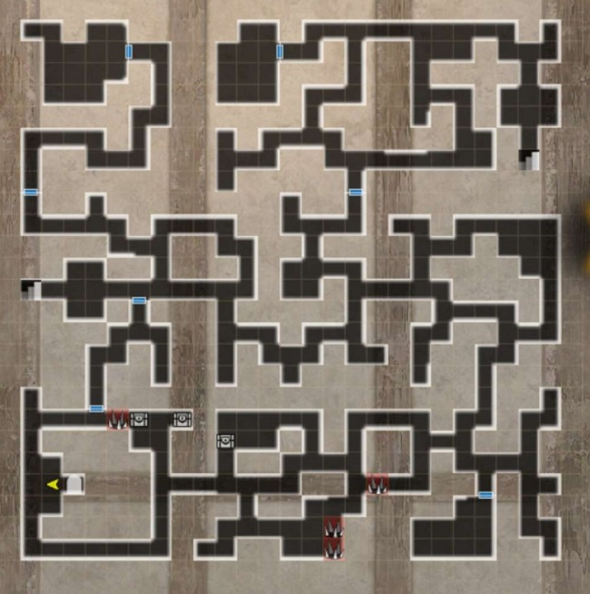
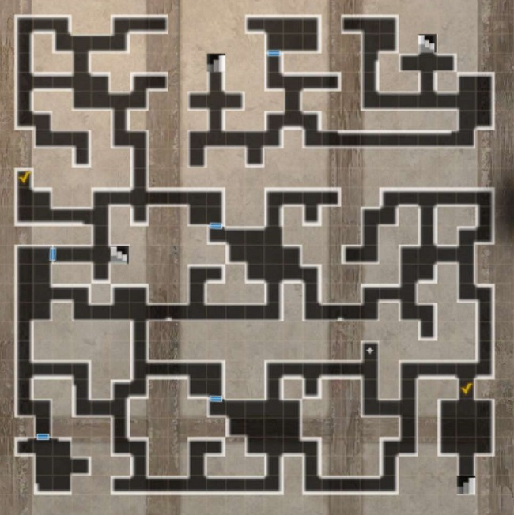
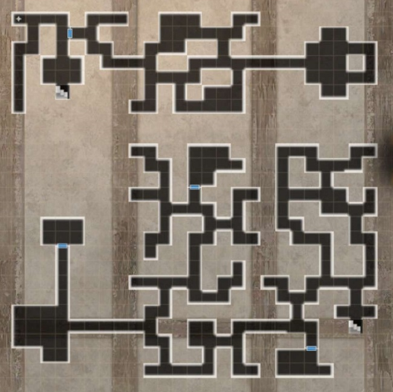

# Vendetta on the Island of the Wailing Oni 

!!! item "This event is permanently available."

## Unlock Conditions

- The first part requires reaching Route 5 of Abyss 4.
- The second part requires the first part and a bad ending of Abyss 4.

## Overview

??? note "How to Accept the Request" 

    - The request is located at the Royal Capital Luknalia in the Adventurer's Guild > Requests > Featured > "Recovery of Oni Treasure".
    - Head to Port Town Grand Legion from the world map after accepting the request. Talk with the sailor in town and 'board the ship'.
    - You can leave and re-enter from the world map at any time. 'Island of the Fire Oni' is east of Port Town Grand Legion.

## Guide for Island of the Wailing Oni (First Part)

!!! note "1st Run"

    === "Guide"
        1. Enter B1F and interact with the Samurai. Help him, as he is necessary for progression. Give him a Medicinal Herb (it pulls from town storage) or Dried Abalone. It doesn't matter which. Afterwards, take the western stairs to the next floor.
        2. On B2F, head to the southern middle region and pick up the letter from a dead samurai. Have Kanosuke read it and ask for his help. Continue onwards east. A boss fight awaits before the stairs, a Minotaur and two Lesser Demons.
        3. On B3F, head to the bottom left room to fight the Red Oni final boss.
            - If you helped Kansouke, he will slay the boss when it's has low health. 
        !!! warning "MC Getting killed by the Red Oni at the end of B3F within your first run will completely reset your request." 
        4. Ignore the new Red Oni and pick up a key in the center of the boss room. Open the locked room in northern B3F and read the journal on the shelf for key knowledge. 
        5. The request cannot be completed any further, so use the Cursed Wheel to reset the request.
        
    === "Red Oni Boss Fight Details"
    
        - ~35k health. Spawns with 2 Red Hobgoblins with ~2k health in the same row. 
        - Is a fire element giant and uses fire elemental skills.
        - Has very high accuracy (over 300).
        - Boss periodically summons a new Red Hobgoblin out of turn. 
        - Red Hobgoblins will charge an attack out of turn.
        - Boss action Blazing Strike is a front-row single-target attack that deals 1400-1700 fire damage, ignoring armor. 
            - Healer/Knight/fire resistance highly recommended. 
            - Alternatively, put MC in the back row and just reverse the occasional deaths.
        - Acts twice often, with a very high chance of using one action to summon a Red Hobgoblin if one is dead.
        - Can be Crit and delayed. Batilgref recommended.
        - Scripted end of fight at 20% boss health if Kanosuke was rescued.
        
!!! note "2nd Run"

    === "Guide"
    
        1. Take the request from the guild once again and reach the island through Port Town. Save Kanosuke from hunger and give him the letter you previously obtained. Mention the growing of horns. He will now follow you and help you read foreign text throughout the dungeon.
        2. On B1F, head to the Archive Room (top left locked room). It will be locked, but Kanosuke tells you to search for a hidden clue. 
            - The clue will be on B2F at the westernmost wall (X:1, Y:17). 
            - With clue obtained, Kanosuke will then mark the key's location on your map with an exclamation mark on the same floor (X:18, Y:13). 
        3. Head back to the Archive Room and read all the texts on the shelves. You discover that you need to stop the Oni transformation through the shrine on the alternate section of B3F.
        4. Take the northeast stairs on B1F and follow the path to the Shrine to northeastern B3F. 
        5. After interacting with the shrine, you learn you need to repair it with paper seals (archive room on B1F) and salt from the pantry (bottom left room of B2F). Head back to the shrine and let Kanosuke fix it.
        6. Head to the boss room and fight the Oni again. Upon winning, head to the middle locked room on B3F and read the diary. Head back to the Oni boss room and go into the treasure room to receive Kansouke as a bondmate (Bind Tolerance), a gold statue for the request, and a request to deliver a letter to his Samurai Dojo.
        
    === "Red Oni Boss Fight Details"
    
        - ~35k health. Spawns with 2 Red Hobgoblins with ~2k health in the same row. 
        - Is a fire element giant and uses fire elemental skills.
        - Has very high accuracy (over 300).
        - Boss periodically summons a new Red Hobgoblin out of turn. 
        - Red Hobgoblins will charge an attack out of turn.
        - Boss action Blazing Strike is a front-row single-target attack that deals 1400-1700 fire damage, ignoring armor. 
            - Healer/Knight/fire resistance highly recommended. 
            - Alternatively, put MC in the back row and just reverse the occasional deaths.
        - Acts twice often, with a very high chance of using one action to summon a Red Hobgoblin if one is dead.
        - Can be Crit and delayed. Batilgref recommended.
        - Scripted end of fight at 20% boss health if Kanosuke was rescued.
         

## Maps

??? map "B1F"
    

??? map "B2F"
    

??? map "B3F"
    

## Guide for Rock-Heart Style Dojo (Second Part)
!!! note "Guide"

    === "Intro"
    
        1. Head to Rock-Heart Style Dojo from the world map, located east of Guarda Fortress.
        2. You will be forced to choose a side amidst a power dispute.
            - Evil will be forced to side with the young man, good with the old man, and neutral may freely choose.
                - The old man's path forces you into the samurai guiding light.
                - The young man's path lets you choose between two choices later. Guiding light, or a white 1* silver-tier katana with humanoid-slayer. 
        3. You will be forced into a fight with the opposing side. 
            - Either of the fights consist of enemies that cannot die, but surviving for 3 turns causes a scripted end.
        4. You will now be tasked with going through three different trials.
        5. (Optional) Each trial has an optional samurai you can fight 1-on-1 with the MC.
            - Each victory gives MC samurai a slightly higher level for all the remaining 1-on-1 fights.
        
    === "First Trial"
     
        1. The gimmick of this floor is to light interactable torches throughout the map in a specific order. 
            - The torch by the entrance will always be the first torch in sequence. 
            - Upon lighting a torch, it will indicate the direction you need to go for the next one. 
            - The next torch in sequence will always be on the exact same X or Y axis as the previous torch and not simply just the closest torch in that general direction.
            - If needed, you may interact with the last torch you've lit to have the instructions repeated. 
        2. After the puzzle, the final room will unlock, and you will fight a deputy samurai 1-on-1 as samurai MC. 
        3. Upon winning the fight, head back to the entrance to unlock the next trial.
        
    === "Second Trial"
    
        1. In this trial, you will need to carry a bowl of water to a final location without spilling too much on the way there.  
            - Some of the water will spill out every time you are hit in battle.
            - If all of it is spilled, you need to head back to the entrance for more.
        2. The main gimmick of this trial is that the final destination is located in a room that is only accessible via teleport pads scattered throughout the map.
            - See maps below for fastest route to the correct location.
        3. Another deputy samurai is waiting for another 1-on-1 fight but is slightly higher in difficulty. 
        4. Return to the entrance to unlock the next trial.
        
    === "Third Trial"
    
        1. First you must defeat 4 different samurai disciples 1-on-1 in 4 different rooms spread throughout the map. 
            - Each disciple will imbue a certain element during the fight, and you can counter that element with your own imbue.
            - They each have their own fighting patterns, but generally they can all be defeated using quickdraw stance if they don't have an evasion buff. 
            - If they are known to use quickdraw stance, then only use your own quickdraw stance after they use theirs. 
        2. The bottom left room will now be unlocked for you to face yet another deputy samurai of a higher level
        3. Return to the entrance to continue the trial. 
        4. Head to the center room of the map to meet the old man. He will test you with QTE.
            - If you sided with the young man earlier, failing the QTE once will cause him to to be unimpressed with the old man, skipping the QTE.
            - If you sided with the old man earlier, you will need to successfully pass three QTE events in a row.
                - Failure of QTE causes damage to MC, and you can fail twice before you are killed.
                - You may select the withdraw option to heal up before trying again.
        5. A final confrontation between the old man and young man will occur.
            - Here you may need to pick a side again depending on your earlier choices and MC alignment. 
            - You MUST protect the old man(Seigen) if you want to receive the samurai guiding light.
            - Siding with the young man(Touma) is only available if you sided with him at the beginning and awards a white 1* silver-tier katana with humanoid-slayer instead of the samurai guiding light.
        6. You'll be thrown into a fight against the opposite selection. Your MC will be a samurai with fixed equipment, fighting alongside your usual party of six.
            - The old man will be by himself for his fight, and the young man will be with 5 samurai deputies with himself in the back.
        7. If you are evil and protected the old man, you must come back to the final room of this trial and challenge the old man's 3 QTE to obtain the samurai guiding light.

        
## Maps
    
??? map "Ascetic Grounds of the Body" 
    
    
    !!! warning "The map layout can be different, but the lamps are always in the same location" 

??? map "Ascetic Grounds of Technique"
    

??? map "Ascetic Grounds of the Mind"
     

## Optional Boss Fight

??? danger "Deranged Sword Fiend"

    

    - Non elemental Humanoid type. Always has 3 actions per turn. Has around 40k HP. All of his attacks have a chance to apply confusion. He also has around 150 Surety Evasion. Has around 130-150 ASPD (varies)
    - His attacks can be entirely evaded but will need very high evasion (400+ total with buffs). 160 ASPD is enough to outspeed him turn 1 consistently.
    - On his first three actions he will always use an elemental-bearer skill, debuff a row with DEF and ATK down, and then give himself 40 turns of evasion up (Very high evasion boost). It's recommended to dispel this evasion buff ASAP.
    - He will typically just use his turns to use normal samurai attacks (Decisive Torso Strike, normal attacks, Bamboo Splitter, Quickdraw Stance). The quickdraw stance does enough damage to instantly kill a unit even in the back row that is defending, so it's recommended to cancel it with a magic damaging skill.
    - After he takes around 8k damage, he will apply 6 turns of Self-Healing on himself out of turn, which immediately recovers 1000 HP and 500 per his action. Whenever this Self-Healing buff is naturally over, he will re-apply it.
    - After taking around 20k damage, he will self-buff with 40 turns of DEF, MDEF, and CT UP. At this point, all of his attacks do significantly more damage. He will also gain a chance at evading magic damage (so be careful if relying on Malefic Wind to dispel his buffs).
    - Upon being defeated, he will drop some Red Gourd currency, some gold-sell items, some Unusual level junk, and a small chance at obtaining an Oni Island Yoto, which is a unique Yoto Odachi that has a chance to inflict confusion per attack at the cost of reducing self DEF/MDEF.
